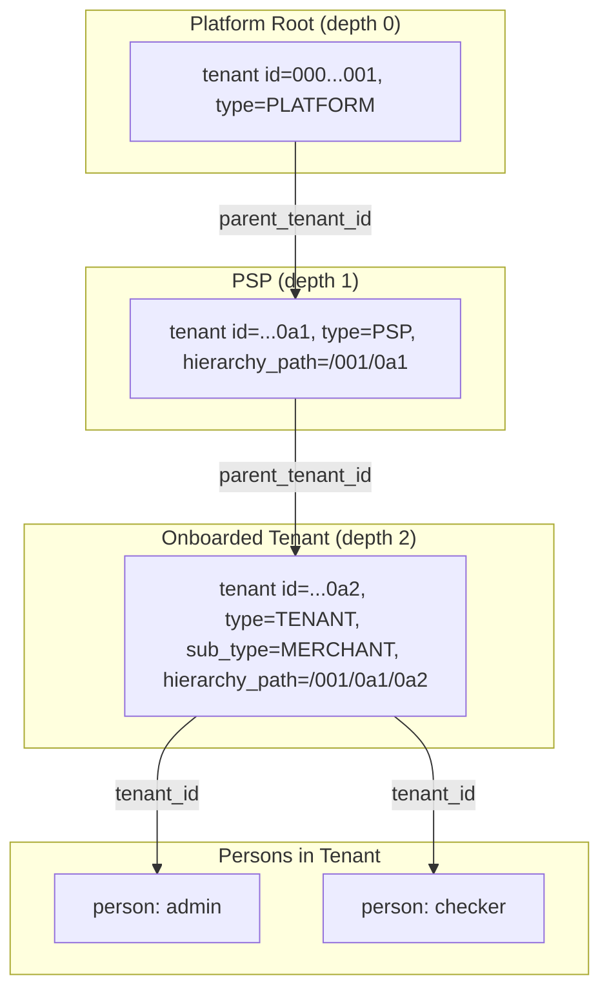
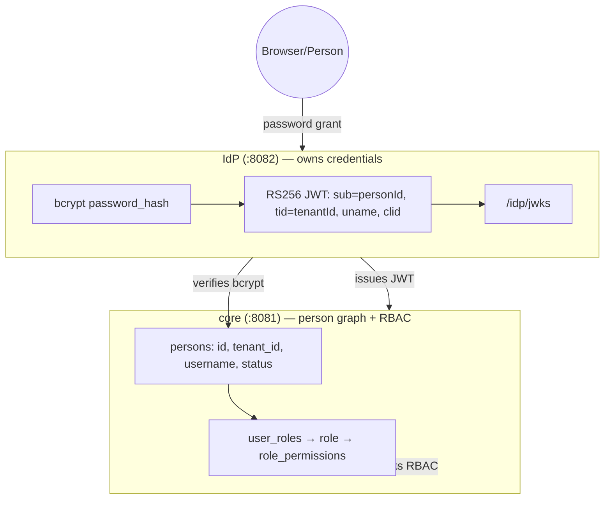
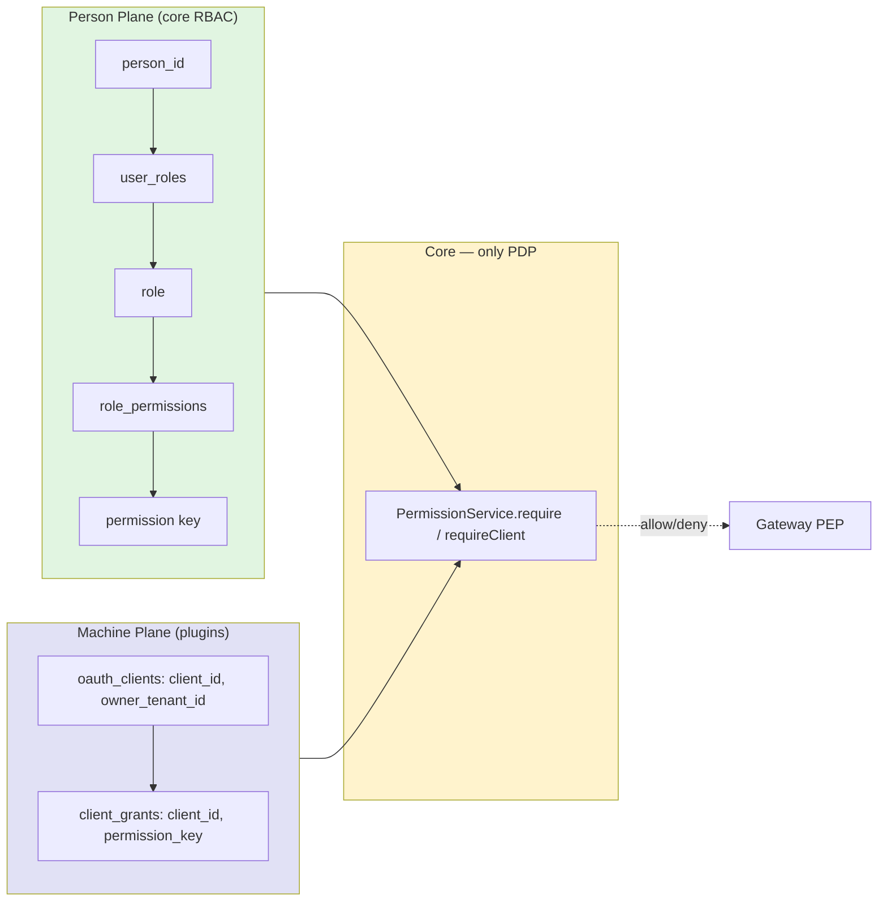

# AGENTS.md — Mandatory Read for Every Agent Working on FSP

**Last updated:** 2026-11-18 · **Owner:** platform engineering
**PRD:** `plans/phase-0-prd.md` · **Architecture:** `vision.md` · **UI standard:** `ui-std.md` · **Backend guide:** `FSP-Spring-Boot-FAPI2-Implementation-Guide (1).md` · **Plugins:** `plans/plugin-platform-plan.md` · **Act-as:** `plans/act-as-tenant-plan.md`
**Reference project (actors + KYC forms):** `/home/arun/sme` (MiPay SME)

> Every agent (human or AI) MUST follow this file. If a task conflicts with this
> file, the conflict is raised before code is written — never silently resolved.

---

## 1. Toolchain rules (hard)

| Area | Rule |
|---|---|
| Backend language | **Pure Java 25.** NO Kotlin anywhere in `backend/`. Do not reintroduce Kotlin plugins/sources. |
| Spring Boot | **4.0.9** (pinned in root `backend/build.gradle.kts`) |
| Gradle | **9.9.1** via wrapper (`backend/gradlew`). Do not downgrade. |
| Frontend | **Bun only**. Never `npm`/`yarn` (`package.json` uses `bunx --bun` scripts; lockfile is `bun.lock`) |
| Frontend stack | Vite + React 18 + TypeScript **strict** (no `any`; ESLint blocks it) |
| TigerBeetle | Server **0.17.9** host binary at `infrastructure/bin/tigerbeetle`; Java client pinned **0.17.9** — bump both together, never one alone |
| Docker compose | **PostgreSQL only.** TigerBeetle runs as a host binary (Docker 25+ seccomp blocks io_uring). Do not add TB back to compose. |
| JDK install | `.sdkmanrc` pins `java=25.0.5.0+8-tem`. Use `sdk env`. |

## 2. Seeding rules (CRITICAL — read twice)

There are exactly **two kinds of seed migrations**, and they are isolated:

| Type | Location | Loaded when | Loaded never |
|---|---|---|---|
| **System seed** | `backend/core/src/main/resources/db/seed/system/` | Always (every environment) | — |
| **Demo seed** | `backend/core/src/main/resources/db/seed/demo/` | **ONLY when Spring profile `client-demo` is active** | In ANY other profile |

Enforced by Flyway locations:

- Default (`application.yml`): `classpath:db/migration,classpath:db/seed/system`
- `application-client-demo.yml`: adds `classpath:db/seed/demo`

**Rules:**
1. NEVER add demo data (`demo1234` passwords, fake tenants, Namib Fresh, etc.) to system seed or to migrations in `db/migration/`.
2. NEVER let demo seed run in staging/production. The profile gate is the only mechanism — do not add code that seeds demo data outside `db/seed/demo`.
3. Demo credentials exist ONLY in demo seed: username `psp-admin`, `psp-ops`, `merchant-admin`, `merchant-checker`, password `demo1234`. Password hashes are produced with pgcrypto `crypt(x, gen_salt('bf',10))` — identical bcrypt format to Spring Security.
4. The platform admin bootstrap password is a Flyway placeholder `${fspBootstrapPassword}` supplied from `FSP_BOOTSTRAP_PASSWORD` (default `fsp-admin`, dev only; set the env in real environments).
5. Schema migrations live in `db/migration/V<n>__<desc>.sql`. Applied migrations are **immutable** — never edit one; write a new one. Next: V20 (Flyway numbers `db/migration` and both seed folders in ONE sequence; V17/V18 are seed versions).
6. If a demo profile feature needs runtime-only data (e.g. TB transfers), it belongs to a `@Profile("client-demo")` bean, not to SQL seed, and must be idempotent.

## 2b. Java style mandate

- **Records everywhere a value crosses a boundary**: wire DTOs, service views, plan legs, decision results.
- **Sealed interfaces for domain outcomes**, consumed with switch pattern matching:
  - `ledger.TbResult` (`Ok | DefinitiveRejection | UnknownTransport`) — every TigerBeetle write returns one; no exception-driven control flow for money.
  - `journal.PostingOutcome` (`Committed | Unknown | Rejected`) — posting state transitions.
  - `kyc.KycDecision` (`Approved | Rejected | RequestInfo`).
- **JPA entities stay plain classes with public fields** (JPA requires a no-arg constructor; records are not entities). Everything else prefers records.
- **Where sealed applies:** only to closed, switch-consumed outcome algebras (TbResult, PostingOutcome, KycDecision) — all three must hold: closed variant set, exhaustive-switch consumers, same-concept-different-modes. Wire DTOs are records grouped in `final` container classes (private ctor); never sealed — they are consumed by field access, not dispatched on.
- **Lombok is allowed for logging only**: `@Slf4j` on services/components/filters/advice — never hand-write `Logger` fields. Lombok is NOT to be used for getters/setters/builders on domain or DTO types (records + public-field entities already cover those). Declared in `build.gradle.kts` as `compileOnly` + `annotationProcessor` (BOM-managed version).

### 2c. Logging mandate (Lombok `@Slf4j` + SLF4J/Spring Boot logger)

Log **every important incident** — any exception, and **any negative path the system took** (permission denial, four-eyes rejection, ledger rejection, uncertain commit, recovery P1, KYC manual-review). One structured `key=value` line per incident; `traceId`/`tenantId`/`userId` come from MDC automatically (`ActorContextFilter` sets them, and clears them in `finally`).

| Level | Use for | Examples |
|---|---|---|
| `ERROR` (with exception where present) | Money-integrity / uncertain / P1, unhandled exceptions | `je_commit_unknown`, `je_recovery_p1_...`, TB transport failure, 500s |
| `WARN` | Definitive business rejections & denials (4xx negative paths) | `permission_denied`, `maker_cannot_approve`, `je_transition_conflict`, TB definitive rejection, bad internal credential |
| `INFO` | Milestones of the happy path that auditors care about | `je_submitted`, `coa_provisioned`, `je_posting_committed`, KYC decision, recovery resolved |
| `DEBUG` | Everything else (detailed context for troubleshooting) | plan legs, TB specs, entity snapshots, screening details, per-request actor resolution |

**Output format — two modes:**
- **Default (machine-parsable):** exactly one line per event — `ts=... level=... traceId=... tenantId=... userId=... logger=... msg=... exception=<flattened ' | ' stack>` (pattern lives in `application.yml`).
- **Debug mode (`debug` Spring profile, e.g. `--spring.profiles.active=debug`):** detailed multi-line log with full stack traces, caller line numbers, and `com.fsp` + Hibernate SQL at DEBUG (`application-debug.yml`).

Never log secrets, passwords, tokens, or full identity numbers (mask to last 4). Never re-wrap a Spring `@Transactional` boundary inside try/catch just for logging — the layer that made the decision logs it.

### 2d. Concurrency & locking mandate (no lost/du­plicate transitions)

Money paths must be safe under concurrent calls (two checkers clicking approve at once, double `check-status`, etc.). Three layers, in order of authority:

1. **DB is the source of truth:** every mutable aggregate carrying a state machine (`JournalEntry`, KYC case, tenant, approval request) uses JPA optimistic locking (`@Version` + `version` column bumped on write) **and** a status precondition inside the transition service. Wrong-from-state always fails with `JE_STATE`/`KYC_STATE` — never silently no-ops.
2. **In-process critical sections (`common/KeyLocks`):** non-idempotent sections that must not interleave inside one JVM — TigerBeetle dispatch + terminalization of the SAME aggregate id — are wrapped in a fair `ReentrantLock` keyed by `domain:id` via `KeyLocks.withLock("je-approval", entryId, () -> ...)`. This stops concurrent double-dispatch of the same journal entry; without it two checkers racing both pass the DB precondition before either writes the new status.
   - Always `withLock` (try/finally unlock inside the utility) — never call `lock()` manually.
   - NEVER `synchronized` on shared singletons (`this` of a singleton bean, `static` monitors, string literals) — those are contention or deadlock traps. Striped fair locks by domain key only.
   - Locks guard **dispatch sections**, not read paths and not DB-only transitions (optimistic `@Version` handles those).
3. **Cross-instance (future hardening slice):** when core runs as N replicas, replace the in-JVM stripe with Postgres advisory locks (`pg_advisory_xact_lock(hashtext(key))`) around the same dispatch sections; the `KeyLocks` API is built so only its backing implementation changes.

Race-condition rules: never read-modify-write a balance or state field outside an optimistic-locked save; never dispatch to TigerBeetle twice for the same entry while uncertain — `COMMIT_UNKNOWN` resolution uses the ORIGINAL ids (§3.4); never hold a `KeyLocks` lock while doing a remote client call other than the dispatch itself, and never inside an HTTP callback.

### 2e. Idempotency mandate (every mutating request)

**Positioning:** FAPI 2.0 is an OAuth2/token-security profile (PAR, PKCE, DPoP) and does NOT define idempotency. The FSP implementation guide places idempotency squarely in **FSP core** ("Maker-checker, idempotency, entitlement, journal construction, ledger recovery"; core endpoint samples take `@RequestHeader("Idempotency-Key")`). So idempotency lives at the core resource-server layer (`IdempotencyFilter`, order 2, `/v1/*` mutating methods), orthogonal to the FAPI2 authn wiring — when OAuth2/DPoP lands, this filter is unchanged; it only consumes the already-resolved actor identity.

Rules:
1. Every mutating core request (`POST/PUT/PATCH/DELETE /v1/**`) MUST carry `Idempotency-Key` (1–128 chars of `A-Za-z0-9._-`, UUIDv4 recommended). Missing → `400 IDEMPOTENCY_KEY_REQUIRED`. The BFF forwards the SPA's key; reads/GETs and `/internal/**` are exempt.
2. Semantics per (actor, key): identical retry (same method+path+body hash, original DONE) → **replay the stored response** with header `Idempotency-Replayed: true`; concurrent duplicate while original still PENDING → `409 IDEMPOTENCY_IN_PROGRESS` (+ `Retry-After: 1`); same key with a different payload → `409 IDEMPOTENCY_KEY_REUSED`. 5xx originals are NOT cached (record cleared) so a retry with the same key is allowed; failure handling follows the implementation-guide rule: retry only when the command's idempotency and outcome resolution support it.
3. Records live in `idempotency_records` (V5), unique on `(user_id, request_key)`; insert-first (`PENDING`) before dispatch, updated to `DONE` with status + content-type + response bytes after; a lost insert race is reported as `IDEMPOTENCY_IN_PROGRESS`.
4. This layer NEVER replaces domain invariants — four-eyes, state-machine preconditions (`JE_STATE`), `KeyLocks` dispatch serialization and deterministic TigerBeetle transfer ids stay authoritative. Idempotency deduplicates accidental duplicate HTTP calls; the domain decides whether a retry is semantically meaningful.
5. Key scoping is per maker (`person_id`), matching four-eyes; a checker must always supply their OWN key. Response body cap for cached replay: 1 MiB; retention is unbounded in Phase-0 (purge job = hardening slice).

## 3. Domain invariants (from vision.md — non-negotiable)

1. **Four-eyes at `person_id`**: maker ≠ checker. A person can never approve their own request (KYC, JE, GL account, bank account). Enforced in services, tested in unit tests.
2. **Money**: minor units only. `NUMERIC(20,0)` in Postgres, `long` in Java/TB, **string on the wire** (JS-safe). Currency ISO-4217 alpha-3; TB ledger id = ISO-4217 numeric.
3. **JE engine** (`com.fsp.core.journal`): balanced lines ≥2; **direct debit-to-credit matching** (no star); deterministic transfer IDs `UUIDv5(ns, entryId + ":" + legIndex)`; linked chain except final leg; same-account-both-sides rejected.
4. **Posting state machine**: `DRAFT → PENDING_CHECKER → READY → SUBMITTING → COMMITTED → FINALIZED`, plus `COMMIT_UNKNOWN` and `REJECTED`. Canonical plan (plan_hash + tb transfer ids) is persisted BEFORE submission. Uncertain commits resolve via `lookup_transfers` with the ORIGINAL ids — never fresh ids while uncertain.
5. **No money without a balanced JE per book+currency.** TigerBeetle is written only through `TbService` — nothing else imports `com.tigerbeetle.*`.
6. **Audit at core boundaries** (`AuditService`): intent acceptance, approval resolution, plan persistence, submission, commit confirmation, finalization. Append only; every record carries `correlation_id`.
7. **Outbox for canonical events.** DB mutation + outbox row in one transaction.
8. **Tenant hierarchy**: platform root (depth 0) → PSP (1) → onboarded tenant (2) in Phase-0. `hierarchy_path` stores tenant-id path. Subtree visibility only.



9. **KYC onboarding is one transaction**: `POST /v1/tenants/with-kyc` creates tenant + applicant admin + KYC case + screening + books atomically; any failure rolls back everything. Username from `UsernamePolicy` (business name → reg number → -2,-3…).
10. **Namibian validation** (`NamibiaRules`): BIPA `^([A-Z]{2})?\d{3,10}$` normalized; TIN `^\d{8}$`; branch code `^\d{5,6}$`; UBO threshold ≥ 25%; keep records ≥ 5 years.

## 4. API & BFF conventions

- Core endpoints: `/v1/tenants/...`, `/v1/approvals`, `/v1/...` (typed per PRD §6). Internal login was REMOVED — the IdP owns authentication now (see §4b/§4c).
- Every mutating core request carries `Idempotency-Key` (§2e) — enforced by `IdempotencyFilter`; responses may replay with `Idempotency-Replayed: true`.
- Every `/v1/**` + `/internal/**` request must carry `X-FSP-Internal-Credential` (validated by core filter). The PUBLIC origin is the Api **Gateway** (`:8090`) — nothing but the gateway (and BFF for its session surface) reaches origins.
- BFF (`:8080`) owns the session cookie (`HttpOnly`, `SameSite=Lax`) and proxies `/api/**` → gateway `/v1/**` with the session's IdP token as Bearer. OAuth/IdP tokens NEVER enter the browser.

### 4b. Credentials vs identity (IdP seam — FULFILLED)



- **Credentials belong to the IdP configured for the client, never to core.** The **native FSP IdP service (`:8082`) is that IdP today** (default provider for every tenant — no row in `idp_configs` means FSP_NATIVE). It owns credential verification (bcrypt over `persons.password_hash`), issues RS256 JWTs (issuer `${FSP_IDP_ISSUER:-https://idp.fsp.local}`, aud `fsp-financial-api`), publishes `/idp/jwks`, and introspects. Its only auth seam is `IdpTokenService.grantPassword` — password grant is the Phase-0 bootstrap; the FAPI2 slice swaps in the OIDC/PAR/DPoP flows WITHOUT touching this service's identity contract.
- **Per-tenant IdP policy (vision §3.3):** a tenant admin can override the default by setting `idp_configs` to `THIRD_PARTY` (issuer_url etc. via the internal-hop policy endpoint). Third-party identities federate via `idp_identities (issuer, subject) → person_id`; until the federation client lands, third-party logins surface `503 IDP_EXTERNAL_FEDERATION_PENDING`.
- **Entitlement/RBAC STAYS in core — this is the architecture decision, settled:** IdP = who you are (claims are advisory), gateway = token + catalog + body edge checks (coarse), core = the ONLY policy decision point (PermissionService.requireAny, four-eyes) because RBAC rows live next to the guarded domain and four-eyes/JE checks must be transactional with the domain action. Never split RBAC into a third service; never decide permissions from token claims at the gateway (claims may only PRE-gate, core re-checks).
- Created-via-API persons still get the bootstrap password from `fsp.security.default-person-password` (env `FSP_PERSON_PASSWORD`); the IdP verifies it.
- Errors: RFC-7807 `application/problem+json` with stable `code` + `correlationId` (see `common/ApiException`). Same convention in IdP/gateway problems.
- UI standard (`ui-std.md`) is binding: design tokens only, `PostingStatePill` for every posting state, `COMMIT_UNKNOWN` = danger + "do not retry" (+ Check status), permission-denied shows the specific permission, mobile-first, no window scroll.

### 4c. Service topology (runnable slice — settled)

```text
SPA (:5173) → BFF (:8080, session+CSRF) → API GATEWAY (:8090, sole public origin) ─┬─ /v1/**  → core (:8081, RBAC+domain, TigerBeetle)
                                                                                   └─ /idp/** → idp (:8082, native IdP, RS256/JWKS)
```

- Gateway = edge enforcement point: strips ALL client-sent identity/authorization headers, verifies the Bearer against the IdP JWKS (sig/iss/aud/exp/nbf), re-issues `X-FSP-*` identity + internal credential, routes only catalog-published operations (boot fails until core's catalog is reachable — bounded retries then exit).
- Core + BFF + gateway identity headers: `X-FSP-User-Id/Tenant-Id/Username/Client-Id`; `ActorContextFilter` remains core's last line — defense in depth, not primary.
- **Containerization (settled):** gateway + idp + core + bff each have a Dockerfile and a compose `stack` profile (`make stack-up`); gateway is the intended ONLY published edge in prod (dev publishes internals for parity). TigerBeetle stays on the host (0.17.9 binary, `127.0.0.1:3000`, never exposed); Postgres is the compose default service. IdP signing key is mounted (`FSP_IDP_SIGNING_KEY=/opt/fsp/pki/idp-signing.pem`), never baked into images.

## 5. Testing / acceptance (Phase-0)

- 24 acceptance criteria in PRD §9 are the merge gate; the full-actor E2E must cover: KYC onboarding (5 tabs), atomic rollback, four-eyes (no self-approve, KYC or JE), posting → FINALIZED, recovery of `COMMIT_UNKNOWN` (`check-status`), audit chain with one correlation id, demo profile isolation.
- Unit/property tests: direct matching (gross debits/credits/net/deterministic ids), recovery, self-approval rejection, `NamibiaRules`.
- Frontend: `bun run lint`, `bun run typecheck`, `bun run build` must pass; bundle budget shell < 200 KB gz.

## 5b. MANDATES DISTILLED FROM THE SOURCE DOCUMENTS (never re-derive, never drift)

Full texts: `vision.md`, `ui-std.md`, `FSP-Spring-Boot-FAPI2-Implementation-Guide (1).md`. vision/ui-std are distilled here as binding rules; **FAPI 2.0 is NOT distilled — it defers to the pi skill `fapi2-compliance` (below)**.

### FAPI 2.0 — decisions come from the pi skill, never from memory

All FAPI 2.0 / security-design decisions (trust boundaries, sender-constrained tokens,
DPoP/PAR/PKCE, client authentication, auth-surface error semantics, audit-evidence
tiers, transport security) MUST be made by loading the pi skill first — do NOT
re-derive, restate, or improvise these rules:

```
/skill:fapi2-compliance
(file: ~/.pi/agent/skills/fapi2-compliance/SKILL.md + references/)
```

Load the skill BEFORE any work touching authentication, authorization, tokens,
certificates, or gateway/BFF/IdP security wiring. AGENTS.md intentionally does NOT
duplicate the skill's content — single source of truth keeps this file short. The
only thing recorded here is the set of PROJECT-SETTLED decisions and deliberate
exceptions that bind FSP (resolve any apparent conflict in favor of these):

| Settled decision | Binds |
|---|---|
| Sender-constraint via **DPoP** (RFC 9449); per-container mTLS certs NOT required; mTLS-b optional for partner clients only | §7 |
| Client auth via `private_key_jwt` (BFF); mTLS profile optional for partners | — |
| **Deliberate exception:** `IdpTokenService.grantPassword` password grant exists ONLY as the Phase-0 bootstrap seam; the skill's “no ROPC ever” rule governs everything else; exception is removed in the FAPI2 slice | §4b |
| RBAC/entitlement stays in **CORE** (only policy decision point); IdP = identity, claims advisory | §4b, §6 |
| Internal hop: gateway strips ALL inbound identity headers and re-issues from verified context; core `ActorContextFilter` = defense-in-depth only | — |
| Idempotency lives in core (`IdempotencyFilter`, §2e) — orthogonal to OAuth, never derived from FAPI | §2e |
| Operation catalog: `@FspOperation` + `OperationCatalog` boot gate; operation IDs stable across URL/API changes; permission rename = deliberate role migration; new permission starts with zero grants; boot descriptor ES256-signed (`CatalogDescriptorSigner`, portal-builder key, same trust store as portal bundles); CI verification wiring = hardening ⛏ | — |
| Outbox for every OLGP mutation; never log credentials, DPoP proofs, tokens, bank data, or KYC payloads | §2 (7) |

### From vision.md (architecture v2)

1. **Core domain is NON-PLUGGABLE (vision §2):** RBAC/identity/delegated authority, payment & transaction ledger (TigerBeetle), organization lifecycle & service entitlement, audit & evidence, hierarchy primitive, CoA/JO layer. Plugins (§6) attach around it — never inside it.
2. **Hierarchy & delegation (vision §3):** platform root → PSP → orgs; delegated onboarding workflow (§3.2); IdP policy per tree node resolved by issuer+subject → canonical `person_id` for four-eyes (§3.3); hierarchy path drives subtree visibility (§3.1); inter-org money movement only via balanced JEs per book (§3.5).
3. **Books/GL (vision §4):** tenancy ≠ legal entity ≠ book ≠ TB ledger; ledger id = ISO-4217 numeric; account semantics own debit_bound/credit_bound; GL account lifecycle + provisioning recovery (§4.5 — provision once; any TB rejections roll back the PG tx; re-run safe).
4. **JE layer (vision §5):** direct debit-to-credit matching properties (§5.4 = AGENTS §3.3), batch limit caps legs (§5.5), PostingGroup concept (§5.6), **uncertain-commit recovery protocol (§5.7 = AGENTS §3.4)** — original IDs only, P1 on partial/mismatch, resubmit identical IDs when lookup proves absence; PostingGroup.CommitUnknown is an operator-visible event (§5.6/§5.9). Posting fence + effective-point semantics (§5.9) arrive with the period-close slice.

### From ui-std.md (UI standard)

1. **Design tokens only (§2):** the required semantic color-role set (bg/text/border/action/focus/status/financial) is closed — no component may invent a role. `danger` is reserved for destructive/error; `success` only for confirmed positive outcomes. `financial.pending/committed/unknown` are separate roles from status colors.
2. **Posting state is always explicit (§5.1):** every JE/PostingGroup surface renders the state via `PostingStatePill` using the canonical mapping (DRAFT neutral / PENDING_CHECKER warning "Awaiting approval" / SUBMITTING info pulsing / COMMIT_UNKNOWN **danger** "Ledger outcome unknown — do not retry" / FINALIZED success "Posted" / …). Nothing is "Success" before FINALIZED. COMMIT_UNKNOWN: no retry affordance, a **Check status** action, plan_hash + correlation_id + original transfer IDs surfaced, and a dedicated Uncertain Postings queue for operators.
3. **Four-eyes UI separation (§5.2):** maker and checker are different surfaces; the checker surface renders a read-only diff, maker identity, plan_hash, affected accounts; Maker never sees an approve control; a `403 MAKER_CANNOT_APPROVE` renders an explicit blocked state (never silently hidden).
4. **Amounts (§5.3):** the `Amount` atom only; minor units are the input contract (`<Amount value={1234567} currency="NAD" minorUnits />`); `tabular-nums`, right-aligned; debit/credit coloring via `financial.debit/credit` — a debit is NOT an error; totals come from the API, the client never sums to verify.
5. **React engineering (§6):** function components only; named exports (default only for route modules); one component per file; props named `{Component}Props`; no `any` (`unknown` at boundaries); hooks return objects when >2 values; no business logic in components; error boundaries wrap every route and independent data region.
6. **State & fetching (§7):** server state = TanStack Query (structured array keys with domain prefix); if state can live in the URL it must (filters/sort/page/tabs/as-of); every mutation invalidates affected keys explicitly; **financial mutations are never optimistic**; retries = 1 for idempotent GETs, **zero** auto-retries for money POST/PUT/DELETE — uncertain outcomes surface as COMMIT_UNKNOWN UI with explicit user-driven check-status.
7. **Shell rules (§ binding from AGENTS §4):** design tokens only, mobile-first, no window scroll, skeletons not spinners, forms: Zod schemas per endpoint, validation on blur/submit per §8 of ui-std.

## 5c. FAPI2 compliance ledger (audited vs the pi skill `fapi2-compliance` — update on every slice)

| Guide § | Status |
|---|---|
| §1 trust boundaries / IdP seam | ✅ interior (core consumes trusted headers only; `CredentialPort` seam for bootstrap login) — OAuth exterior = FAPI2 slice ⛏ |
| §1 BFF session | ✅ HttpOnly SameSite cookie, CSRF double-submit (`/bff/csrf` + `XSRF-TOKEN`), session-id rotation on login; core credential never leaves BFF config |
| §2 FAPI2 (PAR/PKCE/DPoP/RAR) | 🟡 machine-plane tranche (client_credentials + private_key_jwt + DPoP, this plan) · person-plane ⛏ tranche 2 |
| §2 internal hop | ✅ BFF strips `X-FSP-*`/`Authorization`/`Cookie`/`Forwarded` on ingress and RE-ISSUES identity from the verified session; core requires the internal credential on every `/v1` + `/internal` call |
| §3 operation catalog | ✅ `@FspOperation` declarations + `OperationCatalog` boot inventory (fails boot on duplicates/unclassified routes) + `/internal/ops/catalog` descriptor **ES256-signed** by `CatalogDescriptorSigner` (portal-builder key, same trust store as portal bundles) + interceptor enforcement; CI publication pipeline = hardening ⛏ (signature exists; CI verification wiring pending) |
| §3 error semantics | ✅ 401/403/404/503 semantics, ProblemDetail + stable code + correlationId, no token/PII echo |
| §4/§4A records + bounded queries | ✅ records mandated (§2b); list endpoints bounded (size 1–100, closed status enums → 400) |
| §5 idempotency | ✅ `IdempotencyFilter` (§2e) |
| §6 abuse controls | 🟡 bodies bounded + methods whitelisted at BFF; rate limiting/DDoS = gateway slice ⛏ |
| §7 audit evidence tiers | ✅ admission/denial, entitlement, maker-checker, posting evidence (plan hash + TB ids + recovery), act-as evidence (ACT_AS_START/END + `acting_tenant_id` + `act_session_id` on every audit row while acting); secrets/PII never logged |
| §8 build sequence | stages 1–3 active; stage 4 (plugin) ✅ P4 complete (KYC plugin + APIs) · P6 complete (core KYC retired); stage 5 (OIDF conformance) ⛏ |

## 6. Third-party plugins & the RBAC contract (decided; binds all future slices)

When tenant-authored plugins arrive (vision §6 — always OUT-of-process, over the API), RBAC barely changes shape; it gains a **machine-identity plane** beside the person plane:



1. **Plugins are machine clients, never persons.** They authenticate at the IdP (Phase-0: password-grant reserved for PEOPLE; FAPI2 slice adds `client_credentials` + DPoP sender constraint). Tokens carry `clid` (client id) + `tid` (owning tenant); roles are EMPTY for machines. A machine actor can NEVER be a maker or checker — four-eyes remains person-anchored, by invariant, enforced as a service precondition (`ApprovalService`/`JournalService` reject actors with empty person plane or `clid` set).
2. **Grants, not roles.** Person plane: person → user_roles → role → role_permissions (unchanged). Machine plane: `oauth_clients` (IdP-registered, owning tenant, status) → `client_grants(tenant_id, client_id, permission_key)` in CORE. `PermissionService` resolves effective keys for client actors with the SAME subtree/reachability chain math; the actor type picks the plane.
3. **Enforcement points unchanged.** Gateway validates the token identically regardless of grant type (RS256/iss/aud + catalog route); core remains the only policy decision point. New plugin ops need NO RBAC migrations — they reuse catalog operations; only grant rows are inserted.
4. **Revocation is instant through DB-truth** (§2d): flip/disable the grant row or client row → next call denied; short token TTL bounds staleness; NO token blacklist infrastructure.
5. **Scoping by reachability:** a plugin installed by a PSP operates under that PSP's subtree; every call passes `requireReachable` exactly like a child-tenant user. No lateral trust: plugins can never call across tenants or as another tenant.
6. **Installing a plugin is itself governed:** client registration/enable/disable is a four-eyes operation on the owning tenant (approval request, TENANT_SCOPE), audited like financial state changes.

7. **Act-as tenant ("sudo into a tenant"):** a person holding `tenant.act_as` at their home tenant can act as any tenant strictly below it. `act_as_sessions` (V14) tracks live sessions; `X-Act-As: <sessionId>` header switches the principal (same person, target tenant, type=DELEGATED). Permissions while acting are capped by the target tenant's ceiling (roles directly at target), so no privilege escalation. Audit `actor_id` is always the real person; `acting_tenant_id`/`act_session_id` name the target. Session TTL: 30 min idle, 8 hours max, one live session per person. Requires RBAC enforce mode.

Implementation slice: FAPI2/federation slice (after role-specific screens). Schema arrives as a NEW migration (V7+), never by editing settled ones.

## 6b. Layout map

```
backend/  Gradle multi-project: core (:8081), bff (:8080), shared, plugins/kyc (:8083)
  core/src/main/java/com/fsp/core/{identity,rbac,tenant,ledger,journal,approval,audit,outbox,common,config,actas,plugin}
  core/src/main/resources/db/{migration,seed/system,seed/demo}
  plugins/kyc/   KYC plugin — own DB (fsp_plugin_kyc), own Flyway history, no core/TB dependency
frontend/ Bun + Vite SPA (design-system/, domains/, routes/, app/)
infrastructure/ docker-compose (postgres only), bin/tigerbeetle, tigerbeetle-data/
plans/    PRDs and build plans
docs/     dev + runbook notes
```

## 7. Transport security — concrete facts (mandatory behavior = pi skill `fapi2-compliance`)

WHAT is mandatory (DPoP vs mTLS, TLS placement, workload mTLS) is defined by the
skill — **load it; never re-derive security rules here**. These are only the concrete
FSP facts that instantiate it:

- **Dev PKI (never skipped):** `make pki` runs `infrastructure/pki/dev-pki.sh` → dev root CA + server identities (`core.p12`, `bff.p12`) + workload client identity (`bff-workload.p12`) + `ca-trust.p12`; outputs gitignored, regenerable, password `${FSP_TLS_PASSWORD:-fsp-dev}`.
- **Profiles:** default dev = plaintext 8080/8081; profile `tls` = HTTPS (core :8443, bff :8444) with those identities, BFF outbound mTLS via `spring.ssl.bundle.jks.bff-mtls`, core `client-auth=need` via `FSP_TLS_CLIENT_AUTH`. prod = managed CA + short-lived certs; the dev CA NEVER ships.
- Production edges: TLS everywhere public, session cookies `Secure`, DPoP proofs bind to the public URI; workload mTLS for internal traffic (BFF→core, plugin→core).
- **TigerBeetle and Postgres are cluster-internal, unauthenticated transports — never expose:** TB binds `127.0.0.1:3000` in dev (Makefile) and sits on the private network in prod; Postgres likewise (compose TLS via managed CA when exposed).
- **Internal credential:** the static `X-FSP-Internal-Credential` is replaced by short-lived, audience-bound signed workload credentials in the FAPI2 slice; the `CredentialPort`/`ActorContextFilter` header seam stays, only the issuance moves.

## 8. Local run

```bash
make infra-up        # postgres
make tb-start        # tigerbeetle (host)
make backend-idp     # idp    :8082  (native FSP IdP, RS256; keys via make pki)
make backend-core    # core   :8081  (add --spring.profiles.active=client-demo for demo seed)
make backend-gateway # gateway:8090  (catalog routes + JWT edge; START AFTER core+idp or let it retry)
make backend-bff     # bff    :8080  (session; login = BFF→gateway→IdP)
make backend-plugin-kyc  # plugin-kyc :8083  (KYC plugin — P4 complete)
make frontend-dev    # spa    :5173  (bun)
make stack-up        # OR: all four services in docker (compose stack profile)
make tb-reset        # wipe ledger data
```

Smoke chain (dev): `GET :8080/bff/csrf` → `POST :8080/bff/auth/login` (session stores IdP token) → `GET :8080/api/**` (BFF→gateway→core with re-issued identity) → direct `:8090/v1/**` needs `Authorization: Bearer <token from /idp/token>`; unknown route → `404 ROUTE_NOT_IN_CATALOG`.

Dev login (system seed): `platform-admin` / `fsp-admin` (or `$FSP_BOOTSTRAP_PASSWORD`).
Demo login (client-demo only): `psp-admin`, `psp-ops`, `merchant-admin`, `merchant-checker` / `demo1234`.

## 9. Living architecture doc (mandatory)

`docs/architecture.md` is the architecture document, kept live in two tiers:

1. **Generators (`docs/gen/refresh.cjs`) auto-maintain `docs/generated/*`** — fingerprint,
   Gradle dependency graph, `@FspOperation` catalog, Flyway ledger. Run `make docs-refresh`
   before committing; `make docs-check` is the CI gate. Install the auto-run hook once with
   `make docs-hook`.
2. **Prose sections §1–§13/§15 of `docs/architecture.md` are updated in the same PR** whenever a
   change is structural: new service or Gradle module, new package, new cross-service flow,
   invariant change, new migration, new plugin, portal/widget surface change. If your PR
   changes `docs/generated/*` (fingerprint moves), scan the diff: did anything structural
   move? If yes, edit the affected prose sections — do not leave the narrative stale.
