# FSP Architecture — The Living Document

> **Status:** auto-maintained. The §14 *Live Document* tooling regenerates the
> fingerprint, dependency and migration diagrams from the source on every change;
> the prose sections explain *why* and are updated on structural change.
>
> **Audience:** anyone — engineer, reviewer, auditor or newcomer. Every section
> leads with a diagram, then the short prose a newcomer needs, then precision
> detail for implementers.
>
> Sources of truth: `AGENTS.md` (rules), `vision.md` (architecture v2),
> `plans/phase-0-prd.md` (scope). This doc never contradicts them; if it seems
> to, the rule file wins and this doc must be fixed.

---

## Table of contents

1. [Big picture](#1-big-picture)
2. [Runtime topology & ports](#2-runtime-topology--ports)
3. [Request lifecycle](#3-request-lifecycle)
4. [Identity & security model](#4-identity--security-model)
5. [Multi-tenancy, RBAC & delegation](#5-multi-tenancy-rbac--delegation)
6. [The money engine — books, CoA, JE, TigerBeetle](#6-the-money-engine)
7. [Four-eyes approvals & idempotency](#7-four-eyes-approvals--idempotency)
8. [Audit, outbox & evidence](#8-audit-outbox--evidence)
9. [Plugin platform & KYC](#9-plugin-platform--kyc)
10. [Frontend — portals & widget harness](#10-frontend--portals--widget-harness)
11. [Data model](#11-data-model)
12. [Operations — environments, runbook, tests](#12-operations)
13. [Cross-cutting invariants (quick reference)](#13-cross-cutting-invariants)
14. [Live document — how this file updates itself](#14-live-document)
15. [Glossary](#15-glossary)

---

## 1. Big picture

FSP is a **multi-tenant payments & financial services platform** for Namibia:
a PSP (payment service provider) onboards supply-chain tenants (merchants,
manufacturers, distributors, wholesalers) and every rands-and-cents movement
runs through a **double-entry journal engine backed by TigerBeetle**, a
financial-grade ledger database.

One sentence to remember: **the browser never holds a token; money never moves
without a balanced, approved journal entry; and every decision is audited.**

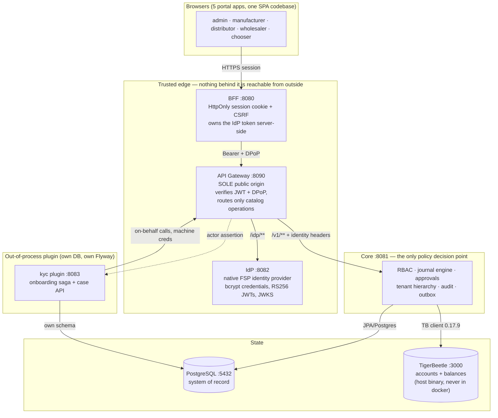

### The five core ideas (everything else follows)

| # | Idea | Where |
|---|------|-------|
| 1 | **Credentials belong to the IdP; entitlements belong to core.** The IdP answers *who you are*; core answers *what you may do*. Token claims are advisory — core always re-checks RBAC transactionally with the domain action. | §4, §5 |
| 2 | **Core is the only PDP; the gateway is the edge PEP.** The gateway verifies the token and re-issues identity headers; core re-verifies with `ActorContextFilter` (defense in depth). | §4.4 |
| 3 | **No money without a balanced JE.** TigerBeetle is written *only* through `TbService`, only via a persisted canonical plan, with deterministic transfer IDs. | §6 |
| 4 | **Four-eyes at `person_id`** — maker ≠ checker — enforced in services, not in UI. Machines (plugin clients) can never be maker or checker. | §7 |
| 5 | **DB is the truth; audit anything a human would need to reconstruct.** Optimistic locking + outbox + append-only audit in the same transaction. | §2d/§8 |

### Module map (Gradle multi-project)

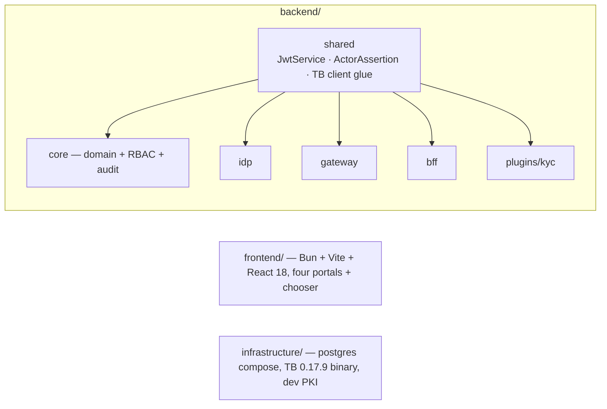

- **shared** — pure-Java crypto/JWT/actor-assertion utilities, no Spring logic.
- **core** — the domain heart: `tenant`, `ledger`, `journal`, `approval`, `audit`,
  `outbox`, `idempotency`, `rbac`, `actas`, `catalog`, `plugin.registry`.
- **idp / gateway / bff** — thin security services; no domain logic.
- **plugins/kyc** — an *example of the plugin pattern* (own DB `fsp_plugin_kyc`,
  own Flyway history, talks to core only through the gateway).

---

## 2. Runtime topology & ports

### 2.1 Processes and ports

| Service | Port (dev) | Container? | Built from | Notes |
|---------|-----------:|------------|-----------|-------|
| SPA (Vite dev) | 5173 | no | `frontend/` | proxies `/bff` & `/api` → 8080 |
| BFF | 8080 | stack profile | `backend/bff` | session cookie, CSRF, DPoP proof gen |
| core | 8081 | stack profile | `backend/core` | Flyway V1–V16, TB client |
| IdP | 8082 | stack profile | `backend/idp` | RS256 `idp-signing.pem` mounted, never baked |
| gateway | 8090 | stack profile | `backend/gateway` | catalog-watched routing (60 s refresh) |
| plugin-kyc | 8083 | stack profile | `backend/plugins/kyc` | own DB/schema, machine credentials |
| PostgreSQL | 5432 | **always** (`postgres:17-alpine`) | compose | system of record for all services |
| TigerBeetle | 127.0.0.1:3000 | **host binary** | `infrastructure/bin/tigerbeetle` 0.17.9 | io_uring does not survive container seccomp — deliberately *not* dockerized |

### 2.2 The one edge rule

Only `:8080` (BFF, for its session surface) and `:8090` (gateway, for everything else)
are intended public origins in production; dev publishes internals for parity.
In prod topology, TLS terminates at BFF/gateway edges; core, IdP, Postgres and
TigerBeetle sit on the private network.

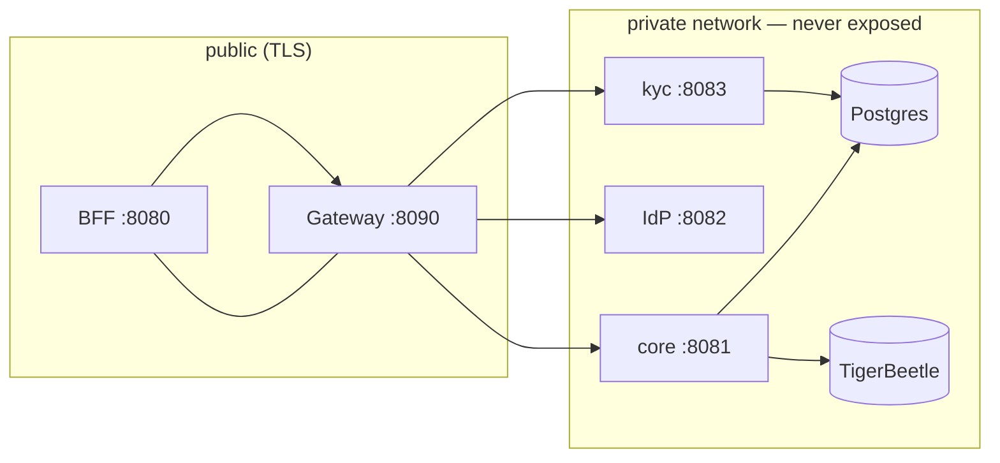

### 2.3 The dev PKI tree

`make pki` regenerates `infrastructure/pki/dev/` — a dev root CA and identities
per service (`core.p12`, `bff.p12`, `gateway.p12` …), a workload client identity
(`bff-workload.p12`) for mTLS between BFF→core under the `tls` profile, the IdP
token-signing key `idp-signing.pem` and the gateway's actor-assertion EC key
`gateway-assertion.pem`. Gitignored, regenerable, never shipped.

---

## 3. Request lifecycle

### 3.1 Login (password grant — Phase-0 bootstrap seam)

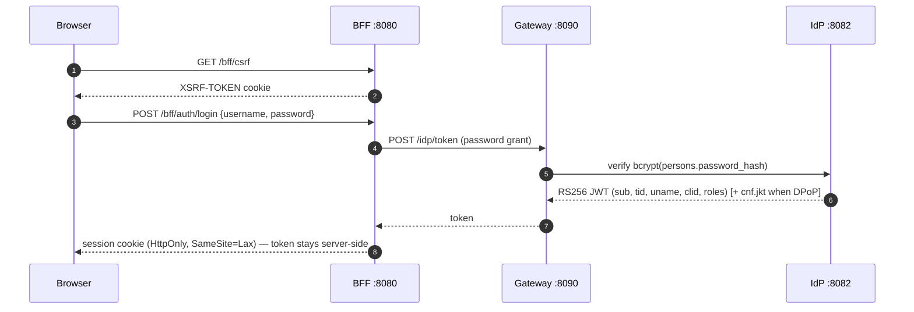

The person plane uses the password grant **only** as the Phase-0 bootstrap; the
FAPI 2.0 slice replaces it with PAR + PKCE (`private_key_jwt` client auth and
DPoP are already wired in `shared`/BFF — see `IMPLEMENTATION_PLAN.md`).

### 3.2 Browser read (`GET /api/...`)

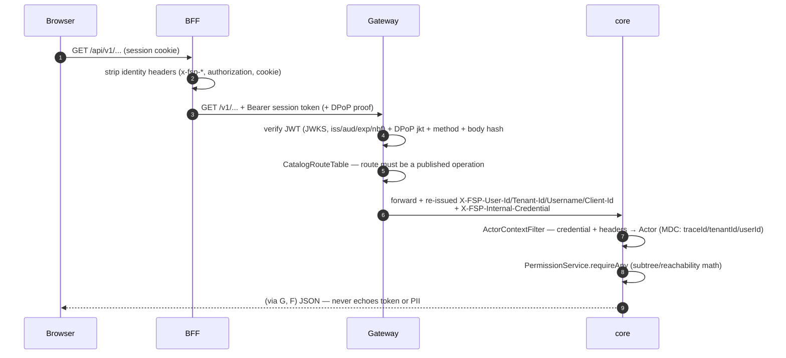

### 3.3 Browser mutation (`POST /v1/...`) — the money path

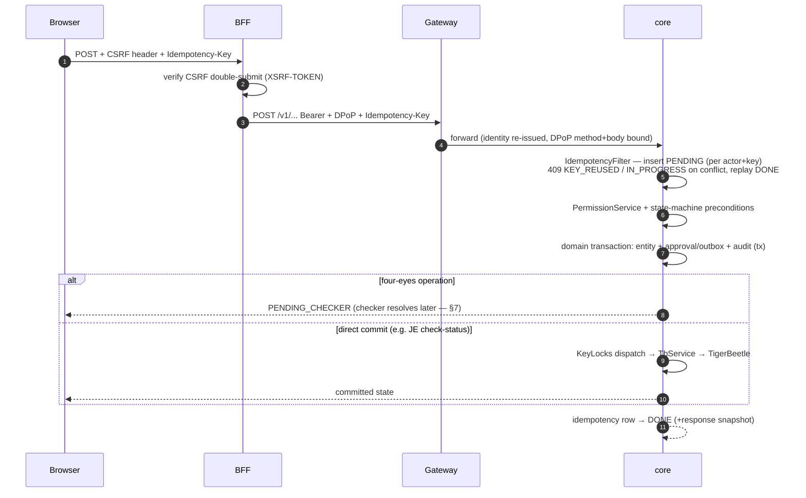

Key rules baked into this flow:

- Missing `Idempotency-Key` on any `/v1` mutation → `400 IDEMPOTENCY_KEY_REQUIRED`
  (`IdempotencyFilter`, order 2). One key per maker, 1–128 chars, UUIDv4 recommended.
- 5xx originals are **not** cached — the record is cleared so the same key may retry.
- The BFF passes the SPA's key through untouched; a checker always supplies her
  **own** key (keys scope per maker alongside four-eyes).
- Money mutations are **never optimistic** in the UI (§7.4 of the UI standard):
  an uncertain outcome shows COMMIT_UNKNOWN with a user-driven *Check status*.

### 3.4 Plugin → core (machine plane, on behalf of a person)

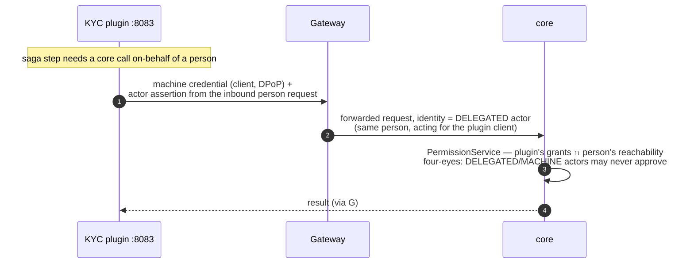

The actor assertion is a 60-second ES256 JWS signed by the *gateway* (the token
never reaches the plugin), bound to `aud=plugin:<code>`, `htm`/`htu`, with a
single-use `jti` budget (plugin inbound = 1; core on-behalf saga = small budget).

---

## 4. Identity & security model

### 4.1 Three actor types (`common/Actor`)

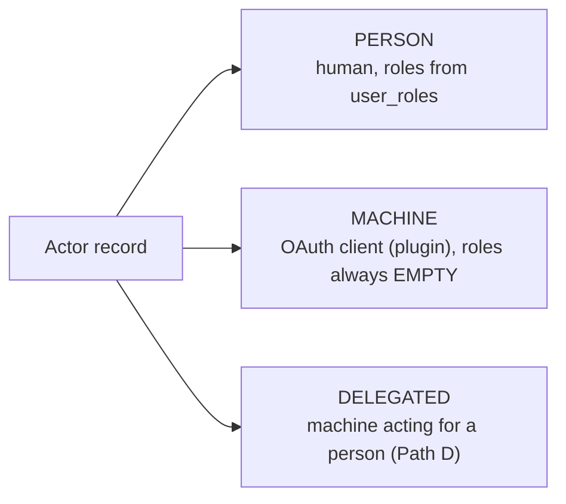

| Invariant | PERSON | MACHINE | DELEGATED |
|---|---|---|---|
| Can be maker of an approval | ✅ | ❌ | ❌ |
| Can be checker (four-eyes) | ✅ | ❌ | ❌ — service precondition in `ApprovalService`/`JournalService` |
| Permissions resolved from | RBAC rows | `client_grants` | min(person RBAC, plugin grants) |
| Token carries | `sub`,`tid`,`uname`,`clid` | `clid`,`tid` | both + actor assertion |

### 4.2 Token & key inventory

| Artifact | Signer | Verifier | Notes |
|---|---|---|---|
| Access JWT (RS256, aud `fsp-financial-api`) | IdP | gateway | claims `sub/tid/uname/clid/roles`, optional `cnf.jkt` for DPoP |
| DPoP proof (ES256, RFC 9449) | client (BFF / plugin) | gateway | binds htm+htu+iat+jti; gateway compares `jkt` to token's `cnf.jkt` |
| `private_key_jwt` client assertion (ES256) | BFF / plugins | IdP | FAPI 2.0 client auth |
| Actor assertion (`typ: fsp-actor+jwt`, ES256, 60 s) | **gateway** (audience `plugin:<code>`) | plugins, core | single-use `jti` budget; htm/htu bound; key `gateway-assertion.pem` |
| Internal credential | env `FSP_INTERNAL_CREDENTIAL` | core `ActorContextFilter` | static in Phase-0; replaced by short-lived audience-bound workload credentials in the FAPI2 slice |
| IdP signing key | — | — | mounted file, never in image |
| Catalog descriptor | ES256 by `CatalogDescriptorSigner` (portal-builder trust store) | gateway/CI | boot gate §4.3 |

All of this lives in `backend/shared` (pure JCA, zero third-party crypto deps).

### 4.3 The operation catalog — how core tells the gateway what may be routed

- Every domain endpoint is annotated `@FspOperation(id = "journal.entry.create",
  permission = "je.create", risk = …)`.
- `OperationCatalog` inventories them **at boot**: duplicates, unclassified routes,
  or missing handlers fail startup.
- The catalog is published as an ES256-signed descriptor (`/internal/ops/catalog`).
- The gateway (`CatalogRouteTable`) watches it (60 s) and routes **only** published
  operations; an unknown path → `404 ROUTE_NOT_IN_CATALOG`. New plugin operations
  need zero RBAC migrations — they reuse catalog IDs; only grant rows change.

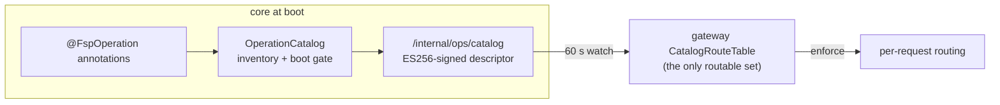

### 4.4 Headers & the trusted hop

Inbound to BFF: all `x-fsp-*`, `authorization`, `cookie`, `forwarded` headers are
stripped (`NEVER_PASSED`) and identity is re-issued *only* from the verified
session/token. Gateway→core strips and re-issues `X-FSP-User-Id/Tenant-Id/Username/Client-Id`
plus the internal credential. `ActorContextFilter` in core is the last line of
defense and sets the MDC (`traceId/tenantId/userId`, cleared in `finally`).

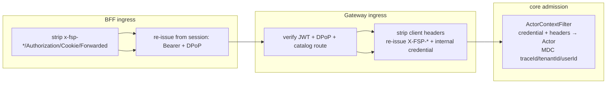

### 4.5 Per-tenant IdP policy

A tenant admin can override the default native IdP by setting
`idp_configs.provider = THIRD_PARTY` (issuer URL etc.). Third-party identities
federate via `idp_identities(issuer, subject) → person_id`; until the federation
client lands, external logins surface `503 IDP_EXTERNAL_FEDERATION_PENDING`.
Entitlements never move — RBAC stays in core (§5).

---

## 5. Multi-tenancy, RBAC & delegation

### 5.1 Tenant tree (Phase-0 depth = 2)

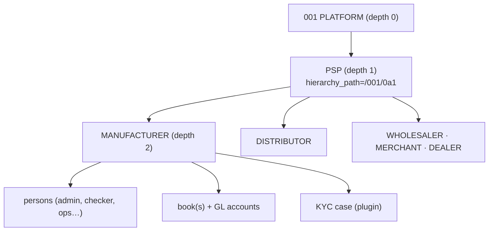

Rules: `hierarchy_path` stores the id path and drives **subtree visibility**
(`requireReachable` = ancestor chain of the target vs the actor's tenant).
Every mutable aggregate carries `@Version` (optimistic locking).

### 5.2 RBAC model

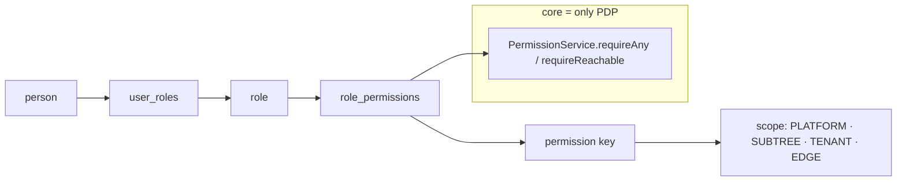

- Scope semantics: `PLATFORM` (root only) · `SUBTREE` (own tenant + below) ·
  `TENANT` (own tenant only) · `EDGE` (direct edges only).
- Permission rename = deliberate role migration with a fresh migration; a new
  permission always starts with **zero grants**.
- Machine plane: `oauth_clients` (IdP) + `client_grants(tenant, client,
  permission_key)` (core) resolve through the *same* reachability math — no
  lateral trust; a PSP-installed plugin operates only inside the PSP's subtree.

### 5.3 Act-as tenant ("sudo into an org")

```mermaid
sequenceDiagram
    participant Admin as PSP admin
    participant CoreA as core (actas)
    participant T as target tenant
    Admin->>CoreA: POST /v1/act-as/start (tenant.act_as at home)
    CoreA->>CoreA: target strictly below home? not suspended?
    CoreA->>CoreA: create act_as_session (TTL: idle 30 min / max 8 h, one live per person)
    Admin->>CoreA: subsequent calls with X-Act-As: <sessionId>
    Note over CoreA: actor type DELEGATED; permissions capped by target-tenant ceiling (roles AT target)<br/>audit keeps actor_id = real person + acting_tenant_id + act_session_id
    Admin->>CoreA: POST /v1/act-as/:sessionId/end
```

Requires RBAC enforce mode; no privilege escalation is possible because grants
while acting are taken from roles directly at the target tenant only.

### 5.4 Onboarding (org lifecycle)

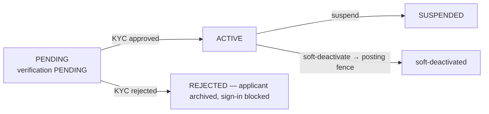

Approval of the KYC case flips tenant → `ACTIVE`, books → `ACTIVE`, and
provisions the chart of accounts automatically (§6.2).

---

## 6. The money engine

### 6.1 The tenancy ≠ entity ≠ book ≠ ledger chain

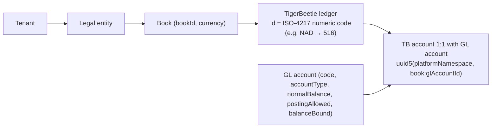

- One book per (tenant, legal entity, currency); shared TB ledger **per currency**.
- TB accounts carry `user_data_128 = glAccountId`, `user_data_64 = tenantHash`,
  `user_data_32 = accountTypeOrdinal`. Reads: `getBalance`, `getAccountBalances`.
- Provisioning model (accounts *and* journal legs): **persist plan → submit to TB →
  confirm → activate**. Any TB rejection rolls back the Postgres tx; re-runs are safe.

### 6.2 Chart of accounts (seeded templates, Phase-0 subset)

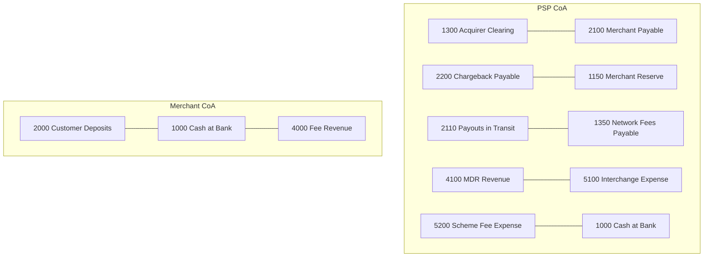

### 6.3 Journal entry anatomy & the posting planner

A JE = `entryId, tenantId, bookId, periodId, currency, lines[] (glAccountId,
direction DEBIT|CREDIT, amount minor units, memo), totalDebits/totalCredits,
status, planHash, tbTransferIds[], makerId, checkerId`.

Balancing is *by construction* (create API rejects unbalanced input). The planner
turns lines into **legs** by *direct debit-to-credit matching* (never "star"):

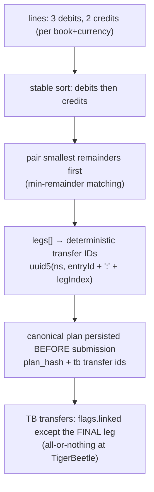

Why it matters: two independent nodes replaying the same entry produce byte-identical
transfer ids — the recovery protocol (§6.5) *depends* on this determinism.

### 6.4 Posting state machine

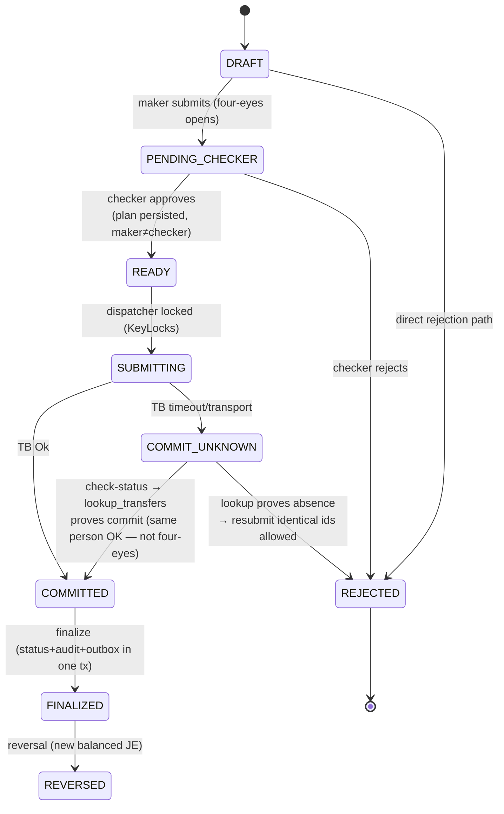

`JournalTx` exists as a *separate* bean so the `@Transactional` transition methods
are never bypassed by self-invocation inside `JournalService`. The sealed
`PostingOutcome` (`Committed | Rejected | Unknown`) is consumed by exhaustive
switch — no exception-driven money control flow.

### 6.5 Uncertain commit — the recovery protocol

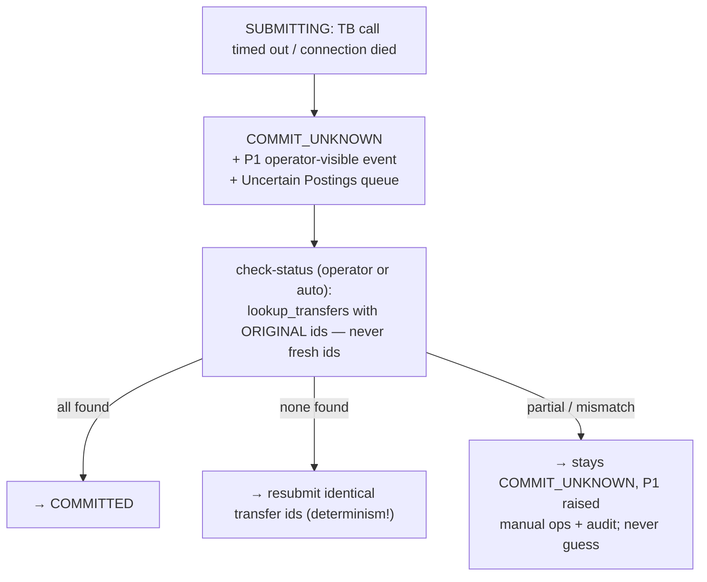

Hard rules: never retry with new ids while uncertain; original ids only, even for
the *retry*, until the outcome is definitively known.

### 6.6 Who may touch TigerBeetle

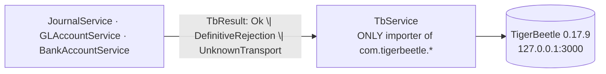

`TbResult` is a sealed algebra: a *definitive* rejection is a business event
(log WARN, terminalize), an *unknown transport* result drives §6.5.

---

## 7. Four-eyes approvals & idempotency

### 7.1 The generic approval engine

```mermaid
flowchart TB
    subgraph MAKER["Maker (person)"]
        M1["open request<br/>(with-kyc, JE submit, GL account,<br/>bank account, plugin install…)"]
    end
    subgraph ENGINE["ApprovalService"]
        OP["approval row PENDING (opType, payload, makerId)<br/>audit: APPROVAL_REQUESTED + outbox"]
    end
    subgraph CHECKER["Checker (person ≠ maker)"]
        C1["decide approve/reject"]
    end
    OP --> C1
    C1 --> RES["ApprovalHandler by OpType (switch)"]
    RES --> DOM["domain effect: activate tenant / post JE / …<br/>audit + outbox in the SAME tx"]
```

- Enforced in service code (maker ≠ checker at `person_id`); the UI renders a
  separate checker surface with a read-only diff, plan hash and maker identity.
- A `403 MAKER_CANNOT_APPROVE` renders an explicit blocked state in the UI —
  never silently hidden.
- Identical retry by the *same* checker is idempotent; conflicting decisions
  fail with a state error.

### 7.2 Idempotency in depth (`IdempotencyFilter`, order 2)

```mermaid
stateDiagram-v2
    [*] --> PENDING: insert-first (user_id, request_key)
    PENDING --> DONE: response stored (status+ct+bytes, cap 1 MiB)
    PENDING --> [*]: 5xx → row cleared (retry allowed)
    DONE --> [*]: same method+path+body-hash → replay<br/>Idempotency-Replayed: true
    PENDING --> [*]: concurrent dup → 409 IDEMPOTENCY_IN_PROGRESS (+Retry-After)
    [*] --> [*]: body hash differs → 409 IDEMPOTENCY_KEY_REUSED
```

Positioning: FAPI 2.0 does not define idempotency — this lives at the core
resource-server layer, orthogonal to OAuth/DPoP, and *never replaces* domain
invariants (§6/§7 stay authoritative).

---

## 8. Audit, outbox & evidence

### 8.1 Write path — one transaction, three writes

```mermaid
flowchart LR
    BIZ["domain mutation<br/>(entity @Version optimistic)"] -->|"same tx"| AUD["audit row<br/>(append-only, correlationId,<br/>before/after state hash,<br/>checkerId, acting_tenant_id)"]
    BIZ -->|"same tx"| OUT["outbox row (canonical event)"]
    BIZ -->|"same tx"| PG2[(Postgres)]
    OUT -->|relay → later| BUS["events for the outside world"]
```

### 8.2 Evidence chain

```mermaid
flowchart LR
    E1["intent acceptance"] --> E2["approval resolution"] --> E3["plan persistence"] --> E4["submission"] --> E5["commit confirmation"] --> E6["finalization"]
    E1 -.->|same correlationId| E6
```

Milestones audited at core boundaries (`AuditService`); the correlation id ties
the whole chain; while acting as a tenant every row carries `acting_tenant_id` +
`act_session_id`. vision.md's later chain-of-chains (Merkle roots + WORM
anchoring) builds on these same rows — schema-ready, transport later.

### 8.3 Logging contract (one line per incident)

| Level | Money path example |
|---|---|
| ERROR + exception | `je_commit_unknown`, `je_recovery_p1_*`, TB transport failure |
| WARN | `permission_denied`, `maker_cannot_approve`, `je_transition_conflict`, TB definitive rejection |
| INFO | `je_submitted`, `coa_provisioned`, `je_posting_committed`, KYC decision |
| DEBUG | plan legs, TB specs, screening details, per-request actor resolution |

Format: single machine-parsable line with `ts/level/traceId/tenantId/userId` from MDC
(`application.yml`); multi-line detail only under the `debug` profile. Secrets,
tokens, DPoP proofs and identity numbers (mask last 4) are never logged.

---

## 9. Plugin platform & KYC

### 9.1 The plugin pattern (out-of-process, always)

```mermaid
flowchart TB
    subgraph Host["FSP host services"]
        GW["gateway :8090 — routes /v1/plugins/<code>/** after readiness check (else 503 PLUGIN_NOT_READY)"]
        C["core — registry + grant rows only"]
    end
    subgraph PK["Plugin process (kyc shown)"]
        API["REST API :8083"]
        DB[("fsp_plugin_kyc DB<br/>own Flyway history")]
    end
    GW --> API
    API --> DB
    C ---|plugin.registry rows| GW
```

Plugins attach **around** the non-pluggable core (RBAC, journal, audit, hierarchy,
CoA are never inside a plugin). Installing a plugin is itself a four-eyes
operation on the owning tenant; enabling/disabling flips DB rows → instant
revocation (short token TTL bounds staleness; no blacklist infra).

### 9.2 KYC plugin — the onboarding saga

```mermaid
sequenceDiagram
    autonumber
    participant PSP as PSP admin (portal)
    participant G as gateway
    participant K as kyc plugin :8083
    participant C as core :8081
    PSP->>G: POST /v1/plugins/kyc/cases (Idempotency-Key)
    G->>K: route (actor assertion minted: aud=plugin:kyc, htm+htu bound)
    K->>K: ActorAssertionFilter — verify ES256, single-use jti<br/>persist case (own DB, own Flyway)
    K->>K: run saga step with deterministic idempotency keys<br/>(crash-safe: resume, never duplicate)
    K->>G: on-behalf core call (machine creds + assertion Path D DELEGATED)
    G->>C: create tenant PENDING + applicant admin + (books suspended)
    C-->>K: ok (if refused → saga marks step failed, rolls forward safely)
    K-->>PSP: 201 case view (via G)
```

- **Case state machine:** `DRAFT → PENDING_REVIEW → APPROVED | REJECTED | REQUEST_INFO`
  (REQUEST_INFO → resubmit loop; four-eyes on the decision; re-opened on bank change).
- **Five-tab data capture** per the SME model: business profile · operations ·
  addresses · UBO & key management (person 1 = applicant admin, `UsernamePolicy`
  generates their username) · settlement bank accounts.
- **Simulated screening:** IDENTITY + SANCTIONS checks (PASS / FAIL / MANUAL_REVIEW);
  a sanctions FAIL blocks approval; risk rating (LOW/MED/HIGH) drives re-review
  cadence (36/24/12 months).
- **Namibian validation** (`NamibiaRules`, plugin-local copy): BIPA
  `^([A-Z]{2})?\d{3,10}$` (normalized), TIN `^\d{8}$`, branch code `^\d{5,6}$`,
  UBO threshold ≥ 25 %, records kept ≥ 5 years.
- **Approval → activation:** case APPROVED ⇒ core tenant ACTIVE + books ACTIVE +
  CoA provisioned + audit chain — the *org activation gate* lives in core; the
  *case workflow* lives in the plugin.

---

## 10. Frontend — portals & widget harness

### 10.1 Build identities

```mermaid
flowchart LR
    SRC["one SPA codebase<br/>(Bun + Vite + React 18, TS strict)"]
    SRC --> ADM["admin.html → admin portal"]
    SRC --> MAN["manufacturer.html"]
    SRC --> DIB["distributor.html"]
    SRC --> WHO["wholesaler.html"]
    SRC --> CH["index.html → chooser"]
    SRC --> WB["widget-workbench.html"]
```

Portals share `OrgApp` and differ only by `portal-config.ts` identity
(name, accent, tenantSubType, menu). Eligibility = session tenant `subType`
(`portalEligible`); the platform admin portal keys on `tenantType=PLATFORM`.

### 10.2 Session hydration (once per portal load)

```mermaid
sequenceDiagram
    participant SPA as portal app
    participant F as BFF
    participant C as core (via gateway)
    SPA->>F: GET /bff/session
    F-->>SPA: user summary (or AUTH_REQUIRED → bounce to login)
    SPA->>C: GET /api/me/permissions
    C-->>SPA: permission keys (RBAC resolve, subtree math)
    SPA->>C: GET /api/tenants/{tid}
    C-->>SPA: tenant subType → portal eligibility
    Note over SPA: TanStack Query keys: [domain, ...] — filters/tabs live in the URL
```

### 10.3 Widget harness

```mermaid
flowchart LR
    subgraph Codegen["bun widgets:* tooling"]
        GEN["widgets:gen → manifest + contracts + fixtures + tests + component"]
        CHK["widgets:check — registry ⇄ backend @FspOperation sync"]
        REG["widgets:register"]
    end
    subgraph Runtime["inside the SPA"]
        HOST["WidgetHost (core host/grid)"] --> REGD["registry (widget id → def)"]
        W["audit · trail widgets (first citizens)"]
    end
    subgraph ServerSide["server"]
        CAT["core catalog /internal/ops/catalog (ES256-signed)"]
        PB["portal builder bundles (same trust store)"]
    end
    GEN --> CHK --> REG
    REGD --> HOST
    CAT -.->|operation ids| CHK
    PB -.->|signed delivery| Runtime
```

A widget = manifest (id, permissions, fixtures, contracts) + a thin component;
screens (`screens.tsx`) are governed route mount points that place widgets by
menu entry. Tooling self-syncs against backend controllers so a widget never
drifts from the operation catalog.

> **How to actually work with the workbench** (author packs by hand or with an LLM,
> preview at every grid tier, register, publish layouts): **`docs/widget-workbench.md`**.

### 10.4 UI standard invariants (why the UI looks the way it does)

| Rule | Meaning on screen |
|---|---|
| Design tokens only | closed semantic color-role set; `danger` reserved for destructive/error |
| PostingStatePill everywhere a posting state shows | DRAFT neutral · PENDING_CHECKER warning · SUBMITTING info pulsing · COMMIT_UNKNOWN **danger** "do not retry" + *Check status* · FINALIZED success |
| Amount atom | minor units input, `tabular-nums`, right-aligned, debit/credit colored — a debit is **not** an error; totals come from the API |
| Four-eyes surfaces | maker vs checker separated; checker sees read-only diff + maker + plan_hash |
| State & fetching | TanStack Query; URL-first state; financial mutations **never optimistic**; zero auto-retries on money POSTs |
| Skeletons, not spinners; no window scroll; mobile-first | shell-wide |

---

## 11. Data model

### 11.1 ER overview (core DB, Flyway V1–V16)

```mermaid
erDiagram
    TENANT ||--o{ PERSON : has
    PERSON ||--o{ USER_ROLE : holds
    USER_ROLE }o--|| ROLE : is
    ROLE ||--o{ ROLE_PERMISSION : grants
    ROLE_PERMISSION }o--|| PERMISSION : references
    TENANT ||--o{ BOOK : owns
    BOOK ||--o{ GL_ACCOUNT : contains
    BOOK ||--o{ JOURNAL_ENTRY : receives
    JOURNAL_ENTRY ||--o{ JOURNAL_LINE : contains
    JOURNAL_ENTRY ||--o{ APPROVAL : "may open"
    PERSON ||--o{ IDEMPOTENCY_RECORD : scopes
    TENANT ||--o{ ACCOUNTING_PERIOD : partitions
    PERSON ||--o{ ACT_AS_SESSION : "sudo sessions"
    TENANT ||--o{ IDP_CONFIG : "IdP policy"
    TENANT ||--o{ OUTBOX : emits
    TENANT ||--o{ AUDIT : evidence
    OAUTH_CLIENT ||--o{ CLIENT_GRANT : "machine plane"
```

### 11.2 Migration ledger (schema is append-only; applied files immutable)

```mermaid
timeline
    title Core DB migrations (next free number: V17)
    V1 : core schema — tenants, persons, RBAC, books, JE, approvals
    V2 : idempotency_records
    V3 : idp_configs / idp_identities
    V4–V7 : plugin platform identity + registry, outbox, audit hardening
    V8 : widget harness + signed portal delivery
    V9–V10 : plugin registry install/enable, core KYC retired
    V14 : act_as_sessions
    V16 : person checker flag
```

Rules: demo data exists **only** under `db/seed/demo` gated by the
`client-demo` profile (never staging/prod); system seed is always loaded;
password hashes are pgcrypto bcrypt (same format Spring Security reads).

Plugin DB (`fsp_plugin_kyc`) has its **own** Flyway history — plugins never
migrate core tables.

---

## 12. Operations

### 12.1 Make targets (dev happy path)

> **Windows-only developer?** Start with `docs/setup-guide.md` (both OSes, full
> troubleshooting) and `docs/windows-dev.md` (Podman/Rancher Desktop, no Docker
> Desktop; scripts `scripts/windows-setup.ps1` + `scripts/dev-windows.ps1`).

```mermaid
flowchart LR
    INFRA["make infra-up<br/>postgres"] --> TB["make tb-start<br/>TigerBeetle :3000"]
    TB --> IDPG["make backend-idp :8082"]
    IDPG --> CORE["make backend-core :8081<br/>(+ client-demo profile for demo seed)"]
    CORE --> GWG["make backend-gateway :8090<br/>(after core+idp, or it retries)"]
    GWG --> BFFG["make backend-bff :8080"]
    BFFG --> PLG["make backend-plugin-kyc :8083"]
    PLG --> S["make frontend-dev :5173"]
    ALT["or: make stack-up (all services dockerized, TB stays host)"]
```

Other targets: `make pki` (dev PKI), `make tb-reset` (wipe ledger), `make test-e2e`
(Playwright). Smoke chain: `GET :8080/bff/csrf` → `POST /bff/auth/login` →
`GET /api/**`; direct `:8090/v1/**` needs a Bearer from `/idp/token`.

### 12.2 Tests as executable architecture

| Layer | Proves |
|---|---|
| Unit + property (backend) | direct debit-credit matching (gross/net/deterministic ids), recovery of COMMIT_UNKNOWN, self-approval rejection, NamibiaRules, RBAC scope math |
| Service tests | state-machine preconditions, four-eyes, idempotency semantics |
| E2E (Playwright) | the PRD §9 acceptance chain: KYC 5-tab onboarding, atomic rollback, four-eyes, posting → FINALIZED, unknown-commit recovery, audit chain one correlation id, demo-profile isolation |
| Frontend gates | `bun run lint` / `typecheck` / `build`; bundle budget < 200 KB gz (shell) |

### 12.3 Configuration & environments

```mermaid
flowchart LR
    subgraph Profiles
        DEF["default dev: plaintext 8080/8081"]
        TLS["profile tls: HTTPS core :8443 / bff :8444<br/>BFF outbound mTLS bundle, core client-auth=need"]
        DEMO["profile client-demo: adds db/seed/demo"]
        DBG["profile debug: multi-line logs + SQL"]
    end
    ENV["env vars: FSP_BOOTSTRAP_PASSWORD · FSP_PERSON_PASSWORD<br/>FSP_INTERNAL_CREDENTIAL · FSP_IDP_ISSUER/SIGNING_KEY · FSP_TLS_PASSWORD"]
```

Prod = managed CA + short-lived certs; the dev CA never ships. IdP signing key
and all identities are mounted, never baked.

---

## 13. Cross-cutting invariants

The one-page checklist every change is measured against (from `AGENTS.md` §2–§8):

| # | Invariant | Enforced by |
|---|---|---|
| 1 | Pure Java 25 backend, no Kotlin; Spring Boot 4.0.9; Gradle 9.9.1 wrapper | build files |
| 2 | Records at boundaries; sealed outcome algebras (`TbResult`, `PostingOutcome`, `KycDecision`) with exhaustive switch; Lombok = logging only | §2b/§2c |
| 3 | One-line structured logs for every incident; MDC correlation; secrets never logged | log pattern + `AuditService` |
| 4 | Optimistic `@Version` + state preconditions + `KeyLocks` dispatch serialization; never `synchronized` on singletons | §2d |
| 5 | Idempotency key on every `/v1` mutation; insert-first semantics; 5xx not cached | `IdempotencyFilter` |
| 6 | Demo data only under `client-demo` seed; migrations immutable; next migration = V17 | Flyway layout |
| 7 | Four-eyes at person_id; machines can never make/check | service preconditions |
| 8 | Minor units (`long`, `NUMERIC(20,0)`, string on wire); TB ledger id = ISO-4217 numeric | `Amount` contract |
| 9 | Balanced JE ≥ 2 lines; direct debit-credit matching; deterministic uuid5 transfer ids; linked chain except final leg | `PostingPlanner` |
| 10 | TigerBeetle is written only via `TbService`; uncertain commits resolve with ORIGINAL ids only | §6.5 |
| 11 | Audit at boundaries + transactional outbox; every record carries correlation id | §8 |
| 12 | Gateway strips & re-issues identity; core is only PDP; claims advisory | §4 |
| 13 | Errors = RFC-7807 problem+json with stable code + correlationId | `common/ApiException` |
| 14 | Out-of-process plugins with own DB; no core-table migrations from plugins | §9 |

---

## 14. Live document — how this file updates itself

This doc stays true to the code through a **two-tier** maintenance model:

```mermaid
flowchart TB
    subgraph Code["source of truth: the code"]
        SRC["java · tsx · sql · yml · gradle"]
    end
    subgraph Gen["Tier 1 — mechanical (automatic)"]
        REFRESH["docs/gen/refresh.cjs"]
        FP["fingerprint.md — per-tree SHA-256"]
        DEPD["dependencies.md — Gradle graph"]
        OPS["operations.md — all @FspOperation"]
        MIG["migrations.md — Flyway ledger + next V-number"]
    end
    subgraph Prose["Tier 2 — human (on structural change)"]
        ARCH["architecture.md §1–§13, §15"]
    end
    SRC --> REFRESH --> FP & DEPD & OPS & MIG
    SRC -."reviewer reads diff on PR".-> ARCH
```

**Tier 1 (generators)** — `docs/gen/refresh.cjs` regenerates `docs/generated/*`
from source. It never edits prose. `--check` mode fails when artifacts are
stale (CI gate + pre-commit). Generated surfaces:

| Artifact | Derived from | Catches |
|---|---|---|
| `fingerprint.md` | per-tree SHA-256 over backend/frontend/migration/infra files | *anything* changed anywhere — a reviewer's "what moved" cue |
| `dependencies.md` | `implementation(project(":…"))` in every `build.gradle.kts` | new service / new module wiring |
| `operations.md` | every `@FspOperation(id, permission, risk)` in core | route/permission/risk contract changes the gateway routes on |
| `migrations.md` | `db/migration/V*.sql` filenames | schema evolution; asserts the next free V-number |

**Tier 2 (prose)** — §§1–13, §15 are human-written. The rule: *a PR that
changes the architecture materially (new service, new package, invariant
change, new cross-service flow) must update the affected sections in the same
PR*. The generated fingerprint is the reviewer's checklist: if it changed,
scan the diff for structural impact.

**Run it**

| When | Command |
|---|---|
| manually | `node docs/gen/refresh.cjs` |
| automatically on commit | `make docs-hook` (installs `.githooks/pre-commit`, needs `git config core.hooksPath .githooks`; it refreshes artifacts and stages them) |
| CI gate | `make docs-check` (fails the build when artifacts are stale) |

```mermaid
sequenceDiagram
    participant Dev as developer
    participant H as pre-commit hook
    participant G as git
    Dev->>G: git commit (code change)
    G->>H: pre-commit
    H->>H: node docs/gen/refresh.cjs
    alt artifacts changed
        H->>G: git add docs/generated/*
    end
    G->>G: commit proceeds (doc + code travel together)
    Note over G,Dev: CI additionally runs make docs-check — staleness can never merge
```

Why two tiers: fully-generated docs drift into unreadability and lose the *why*;
fully-manual docs drift from the code. Generators pin the mechanical truth
(exact operations, exact migration numbers, exact wiring) while humans keep
the narrative. Disagreement is impossible to hide — regenerating fails CI.

## 15. Glossary

| Term | Meaning |
|---|---|
| **Book** | per (tenant, legal entity, currency) accounting container; maps 1:1 into one TB ledger+accounts set |
| **BFF** | Backend-for-frontend; owns the browser session and the IdP token server-side |
| **CoA** | Chart of accounts — the GL account tree of a book |
| **Commit-unknown** | TB outcome not provably committed or rejected; enters the recovery protocol |
| **DPoP** | RFC 9449 sender-constrained tokens; proof-of-possession JWT bound per request |
| **FSP** | Financial Services Platform (this codebase) |
| **Four-eyes** | maker ≠ checker at `person_id`; a person can never approve their own request |
| **JE** | Journal entry — the only way money moves |
| **Leg** | one matched debit-credit pair turned into a TB transfer |
| **Minor units** | integer smallest-currency unit (e.g. cents); string on the wire, long in Java |
| **PAR** | Pushed Authorization Request (FAPI 2.0 OAuth surface, tranche 2) |
| **PDP / PEP** | Policy Decision Point (core) / Policy Enforcement Point (gateway, BFF) |
| **Plan** | canonical posting plan (legs + hash + TB ids) persisted before submission |
| **Posting fence** | blocks new admissions during period close / deactivation |
| **Subtree visibility** | an actor sees only tenants along its `hierarchy_path` |
| **TB** | TigerBeetle, the OLTP financial ledger (v0.17.9, host process) |
| **Widget** | governed UI tile (manifest + contracts + component) placed on portal screens |

---

*Fingerprint, dependency and migration diagrams in §14 are regenerated by
`docs/gen/refresh.cjs` (manual + pre-commit + CI). Regenerate manually:*
`node docs/gen/refresh.cjs && git re-add docs/architecture.md docs/generated/*`.
