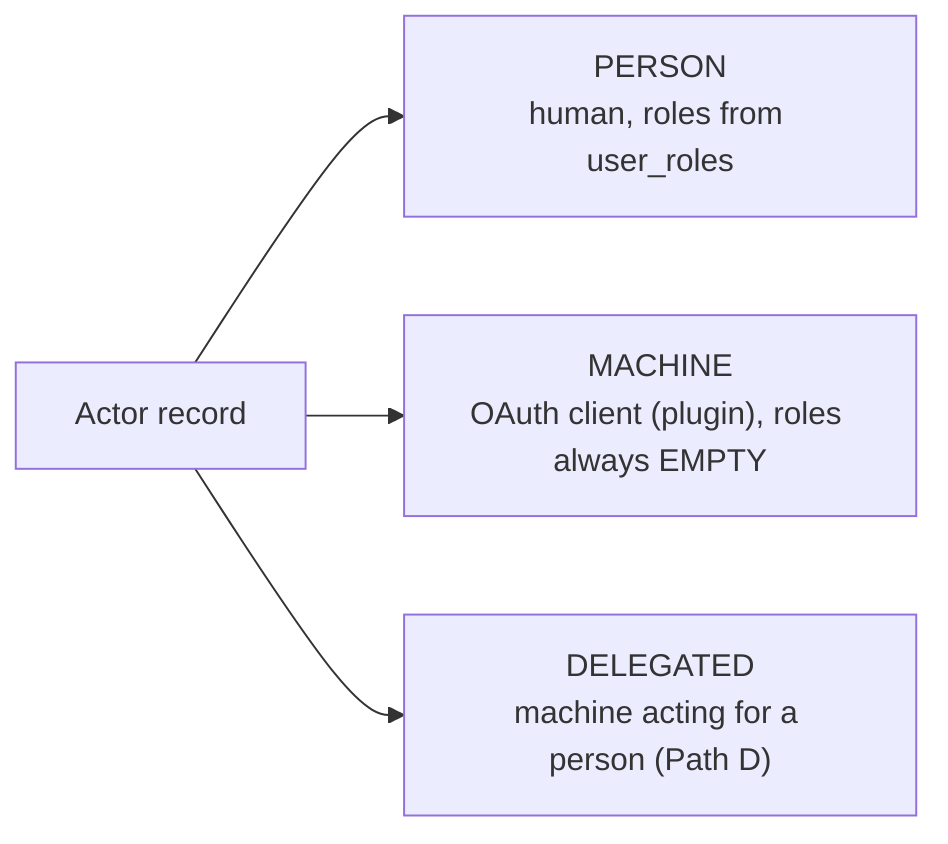
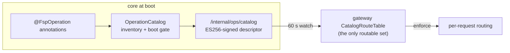
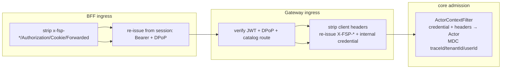

# Architecture Chapter 2 — Identity & Security Model

**Parent Document:** [docs/architecture.md](file:///home/arun/FinancialServicesPlatform/docs/architecture.md)

---

## 1. Three Actor Types (`common/Actor`)

| Invariant | PERSON | MACHINE | DELEGATED |
|---|---|---|---|
| Can be maker of an approval | ✅ | ❌ | ❌ |
| Can be checker (four-eyes) | ✅ | ❌ | ❌ — service precondition in `ApprovalService`/`JournalService` |
| Permissions resolved from | RBAC rows | `client_grants` | min(person RBAC, plugin grants) |
| Token carries | `sub`,`tid`,`uname`,`clid` | `clid`,`tid` | both + actor assertion |

---

## 2. Token & Key Inventory

| Artifact | Signer | Verifier | Notes |
|---|---|---|---|
| Access JWT (RS256, aud `fsp-financial-api`) | IdP | gateway | claims `sub/tid/uname/clid/roles`, optional `cnf.jkt` for DPoP |
| DPoP proof (ES256, RFC 9449) | client (BFF / plugin) | gateway | binds htm+htu+iat+jti; gateway compares `jkt` to token's `cnf.jkt` |
| `private_key_jwt` client assertion (ES256) | BFF / plugins | IdP | FAPI 2.0 client auth |
| Actor assertion (`typ: fsp-actor+jwt`, ES256, 60 s) | **gateway** (audience `plugin:<code>`) | plugins, core | single-use `jti` budget; htm/htu bound; key `gateway-assertion.pem` |
| Internal credential | env `FSP_INTERNAL_CREDENTIAL` | core `ActorContextFilter` | static in Phase-0; replaced by short-lived audience-bound workload credentials in the FAPI2 slice |
| IdP signing key | — | — | mounted file, never in image |
| Catalog descriptor | ES256 by `CatalogDescriptorSigner` (portal-builder trust store) | gateway/CI | boot gate |

All cryptographic signing and verification utilities live in `backend/shared` (pure JCA, zero third-party crypto dependencies).

---

## 3. The Operation Catalog

- Every domain endpoint is annotated `@FspOperation(id = "journal.entry.create", permission = "je.create", risk = …)`.
- `OperationCatalog` inventories them **at boot**: duplicates, unclassified routes, or missing handlers fail startup.
- The catalog is published as an ES256-signed descriptor (`/internal/ops/catalog`).
- The gateway (`CatalogRouteTable`) watches it (60 s) and routes **only** published operations; an unknown path → `404 ROUTE_NOT_IN_CATALOG`. New plugin operations need zero RBAC migrations — they reuse catalog IDs; only grant rows change.

---

## 4. Headers & the Trusted Hop

Inbound to BFF: all `x-fsp-*`, `authorization`, `cookie`, `forwarded` headers are stripped (`NEVER_PASSED`) and identity is re-issued *only* from the verified session/token. Gateway→core strips and re-issues `X-FSP-User-Id/Tenant-Id/Username/Client-Id` plus the internal credential. `ActorContextFilter` in core is the last line of defense and sets the MDC (`traceId/tenantId/userId`, cleared in `finally`).

---

## 5. Per-Tenant IdP Policy

A tenant admin can override the default native IdP by setting `idp_configs.provider = THIRD_PARTY` (issuer URL etc.). Third-party identities federate via `idp_identities(issuer, subject) → person_id`; until the federation client lands, external logins surface `503 IDP_EXTERNAL_FEDERATION_PENDING`. Entitlements never move — RBAC stays in core.
