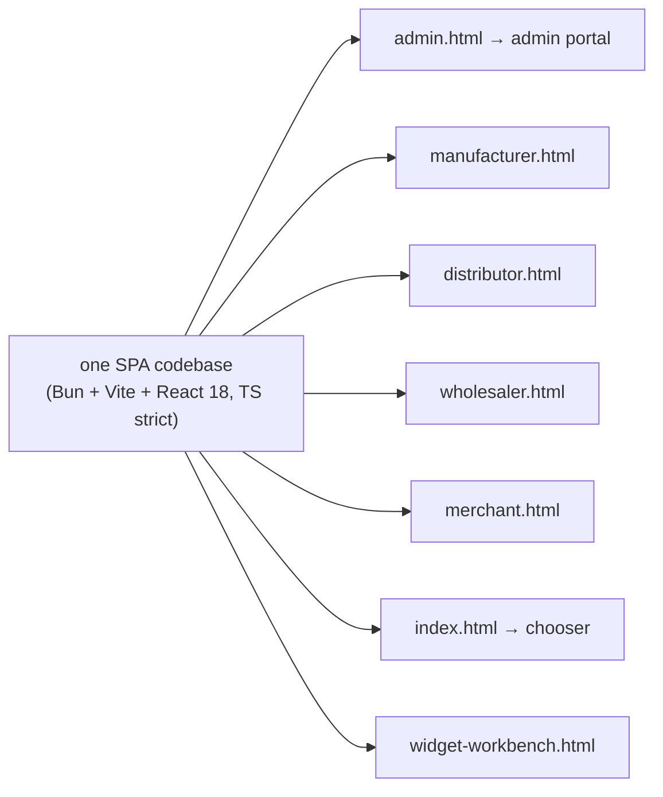
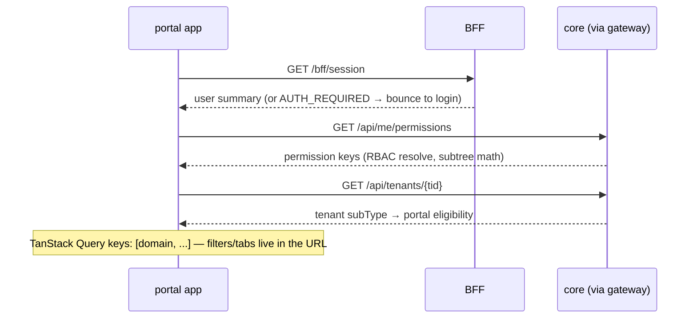
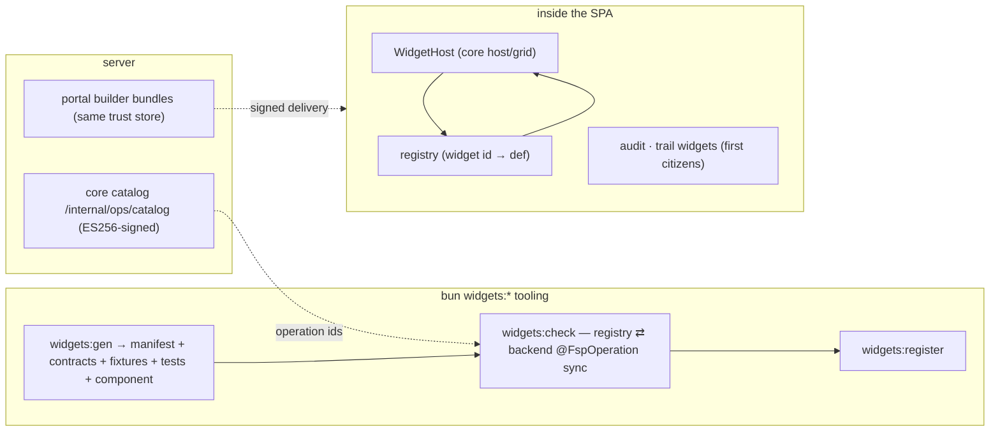

# Architecture Chapter 9 — Frontend, Portals & Widget Harness

**Parent Document:** [docs/architecture.md](file:///home/arun/FinancialServicesPlatform/docs/architecture.md)  
**Normative Standard:** [ui-std.md](file:///home/arun/FinancialServicesPlatform/ui-std.md) · **Workbench Guide:** [docs/widget-workbench.md](file:///home/arun/FinancialServicesPlatform/docs/widget-workbench.md)

---

## 1. Build Identities & Portals

Portals share `OrgApp` and differ only by `portal-config.ts` identity (name, accent, tenantSubType, menu). Eligibility = session tenant `subType` (`portalEligible`). `merchant.html` is the leaf portal (sub-type `MERCHANT`).

---

## 2. Session Hydration (Once per Portal Load)

---

## 3. Widget Harness & Codegen

A widget = manifest (id, permissions, fixtures, contracts) + a thin component. Tooling self-syncs against backend controllers so a widget never drifts from the operation catalog.

---

## 4. UI Standard Invariants

| Rule | Meaning on screen |
|---|---|
| Design tokens only | Closed semantic color-role set; `danger` reserved for destructive/error |
| `PostingStatePill` | Explicit states: `DRAFT` neutral, `PENDING_CHECKER` warning, `SUBMITTING` info pulsing, `COMMIT_UNKNOWN` **danger** ("do not retry" + *Check status*), `FINALIZED` success |
| Amount atom | Minor units input, `tabular-nums`, right-aligned, debit/credit colored |
| Four-eyes surfaces | Maker vs checker separated; checker sees read-only diff + maker + `plan_hash` |
| State & fetching | TanStack Query; URL-first state; server-driven pagination & sorting; financial mutations **never optimistic**; zero auto-retries on money POSTs |
| Skeletons, not spinners | Mobile-first, no window scroll |
