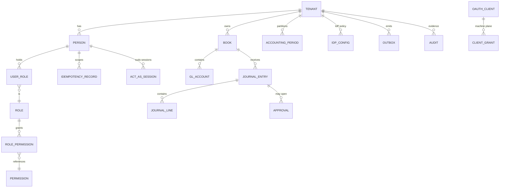
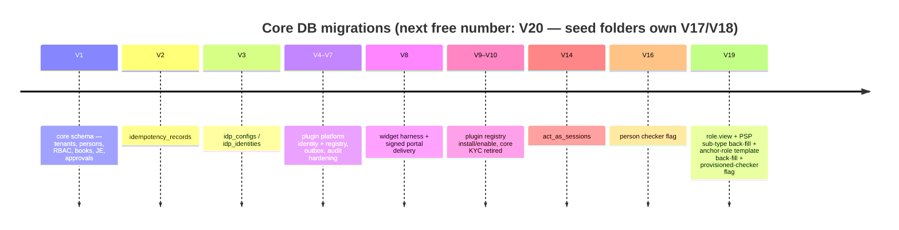

# Architecture Chapter 10 — Data Model & Storage

**Parent Document:** [docs/architecture.md](file:///home/arun/FinancialServicesPlatform/docs/architecture.md)

---

## 1. ER Overview (Core DB, Flyway V1–V16)

---

## 2. Migration Ledger

Rules:
- Applied migrations are **immutable** — never edit an existing migration; write a new one.
- Demo data exists **only** under `db/seed/demo` gated by the `client-demo` profile (never staging/production).
- System seed (`db/seed/system`) runs in every environment.
- Plugin DBs (e.g. `fsp_plugin_kyc`) have their **own separate Flyway history** — plugins never alter core tables.
