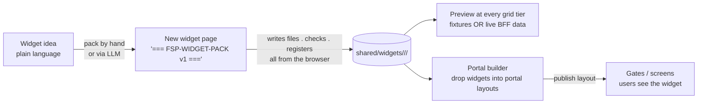

# The Widget Workbench — how to build portal widgets

> Audience: anyone who wants to make a new panel/list/form for an FSP portal — developers
> and anyone driving an LLM (Claude/pi/JetBrains AI) to do the typing.
> Related: `docs/architecture.md` §10 (frontend), `docs/setup-guide.md` (getting the
> platform running first), skill template regenerated by `bun run widgets:skill`.

---

## 1. What the workbench is

The widget workbench is a **special portal inside the SPA** at
**`http://localhost:5173/widget-workbench/`** where widgets are:



- **Registry** — every widget is a folder `frontend/src/portals/shared/widgets/<area>/<name>/`
  with a manifest (`index.tsx`), a component (`widget.tsx`), data mapping + fixtures (`data.ts`).
  Vite imports them all via `registry.ts`; the workbench, the portal builder palette and the
  renderer all share this one list.
- **Two data modes** — *signed out*, widgets render purely from **fixtures** (no backend up,
  nothing touched). *Signed in* (BFF session), the sources hit the real gateway → core
  (permissions re-checked by core; the workbench can grant you nothing core doesn't).
- **Registration** — `PUT /v1/ui/widgets` (core `WidgetRegistryService`) records the widget
  so portal layouts can reference it.

## 2. Start it (per OS)

| Mode | Command | Notes |
|---|---|---|
| Fast (fixtures only) | `cd frontend && bun run workbench` | signs out; opens vite directly on `/widget-workbench/` |
| Full (live data) | `scripts\dev-windows.ps1 dev` **(Windows)** / `make backend-* ; make frontend-dev` **(Linux)** → then open the URL | login via the SPA as any seeded user; your BFF session now feeds live sources |
| URL always | `http://localhost:5173/widget-workbench/` | works in the same vite server as the portals |

Sign in from the workbench's **connection bar** (top). The bar shows which mode you are in
(fixtures vs. live + who you are). No IdP/OAuth tokens ever reach the browser — the BFF
session is the only credential path (AGENTS §4).

## 3. The four places to know

| Workbench page | URL | What it does |
|---|---|---|
| **Widget page** | `/widget-workbench/w/<id>` | the widget isolated: preview across every grid tier (xs→lg), the exact frames the builder will use, live/fixture data toggle, network table of the sources it calls |
| **Registry** | `/widget-workbench/registry` | all widgets + the operations & permissions each one needs; a quick "who breaks if I rename a permission" view |
| **New widget (LLM)** | `/widget-workbench/new` | paste a widget pack; the page writes the files, type-checks, lints, registers and opens the preview. Bad packs are rejected with the rule they broke |
| **Portal builder** | `/widget-workbench/builder` | assemble widgets into a portal layout (grid), review the diff and submit it for another admin's approval — once approved, core publishes + ES256-signs the layout and the portals draw it |

### 3.1 The portal builder flow (four-eyes)

1. **First visit** shows a chooser: *Start from the live portal* (recommended), *Start blank*, or *Import JSON*.
2. **Build.** The left rail IS the portal sidebar (rename inline, drag to reorder, lock notes); the canvas is true-tier width with per-slot `+` chips (`/` opens the add-widget search; the drawer lists only widgets your session can actually render). Undo/redo with `Ctrl+Z` / `Ctrl+Shift+Z`; page deletion is instant with an *Undo* toast.
3. **Submit.** The *Submit for approval* sheet shows blocking checks, what changes go live (a diff against the published layout), and the four-eyes controls: the maker submits, a DIFFERENT admin (`Approve and publish`) or rejects with a reason. While pending, the draft is locked.
4. **Live.** The pill in the header always shows the state: `Live · vX`, `Live · vX · edited`, `Waiting for approval`, `Changes requested`, or `Draft (saved …)`.
5. **Ids.** Menu/page ids that are already live render locked (🔒); renaming keeps auto-derived ids in sync with the label until a page is published once.

Deep links `?view=submit` / `?view=export` open straight into the sheet/export (they seed the editor copy from the live portal when opened in a fresh browser, e.g. a checker following an approval notification).

## 4. Way A — author a pack with an LLM (usual route)

1. **Start the authoring skill.** In pi (or any agent that can read the repo):
   load `docs/skills/fsp-widget-author/SKILL.md` (or `.agents/skills/fsp-widget/SKILL.md`) and give it the requirement, e.g.
   *"a widget showing pending JE approvals for my tenant, with approve/reject"*.
   The skill answers with a **widget pack**: a `=== FSP-WIDGET-PACK v1 ===` block
   containing complete files (`index.tsx` manifest, `widget.tsx` component, `data.ts`
   mapping + fixtures). Only endpoints/fields/permission keys listed in that skill's §8
   are allowed; it cannot invent an API — if data is missing it returns a
   `NEEDS BACKEND` note for a developer to build the endpoint first.
2. **Paste the pack** into **New widget (LLM)**. The page validates and writes:
   `frontend/src/portals/shared/widgets/<area>/<name>/`.
3. **Verify**: `bun run widgets:check` (registry coherence), `bun run lint`,
   `bun run typecheck`, `bun run test` (the pack may include a Vitest file), then look at
   the preview page — every grid tier, fixture and live mode.
4. Register + place: `bun run widgets:register <id>` (or the page already did it), then
   **Portal builder** to drop it into a layout and publish.

## 5. Way B — author by hand (no LLM)

```text
frontend/src/portals/shared/widgets/<area>/<name>/
├── index.tsx      ← defineWidget({ id, version, label, category, contexts,
│                                  requires: [permission], sources, commands,
│                                  actions, size: span.xs/sm/md/lg, render })
├── widget.tsx     ← presentation only (ui-std rules: tokens, Amount atom, …)
├── data.ts        ← sources (TanStack keys + fetch via shared core) + fixtures
└── model.ts       (optional types/helpers)   <name>.test.ts (optional vitest)
```

Then the same loop as above: preview → check → register → builder.

## 6. Command reference (all from `frontend/`)

```bash
bun run workbench          # open the workbench (vite)
bun run widgets:list       # registry + operations grid (terminal view)
bun run widgets:check      # registry coherence — what CI runs too
bun run widgets:gen <id>   # scaffold a fresh widget folder
bun run widgets:register <id>   # PUT /v1/ui/widgets (needs services up)
bun run widgets:skill      # regenerate docs/skills/fsp-widget-author/SKILL.md
                           # from tools/widget-pack/SKILL.template.md (digest-pinned)
```

## 7. Rules the builder enforces (why packs get rejected)

- Manifest fields must be complete and consistent: every `sources`/`commands` name the
  component uses must be defined in `data.ts`; every `action` must carry a **permission
  key** from the catalogue; `requires` uses core permission keys only.
- Grid spans at all four tiers; **fixtures** must render with no backend.
- UI-standard invariants (ui-std.md): design tokens only, `Amount` atom for money,
  no optimistic financial mutations, skeletons not spinners, no `any`.
- The pack format has no placeholders — the validator rejects "…" and partial files
  because partial widgets are how stale UI ships.

## 8. Troubleshooting

| Symptom | Cause → fix |
|---|---|
| Workbench shows no widgets | registry empty → is a widget `index.tsx` failing to parse? `bun run widgets:check` names the offender |
| Widget greyed out in the add-widget drawer | your signed-in user lacks a `requires` permission — sign in as a role that has it (see `docs/setup-guide.md` §5.1 credential table); the drawer also shows a *server still needs to register this widget* note when the id is missing from `/api/ui/widgets` |
| **New widget** rejects pack with `NEEDS BACKEND` | the pack calls an endpoint not in the skill's catalog → a developer adds/extends the endpoint first, regenerate the skill with `bun run widgets:skill` (digest updates), retry |
| Live sources return 403 | expected — core re-checks RBAC; widget's `requires` doesn't match your role's grants |
| Live sources return 401 | BFF session expired → re-login via the connection bar |
| Register fails 400/404 | services down → full stack: `scripts\dev-windows.ps1 dev` (Windows) / make targets (Linux) |
| Preview fine with fixtures, broken live | fixture shape drifted from the real response — fix `data.ts` mapping from the network table in the widget page |

---

## 9. Agent Decision Guide & Workflow (When to Engage & When to Add Menu Items)

AI agents working on feature requests or tasks must follow these rules:

### 9.1 When to Engage with the Widget Pipeline
Engage with the widget pipeline whenever a requirement involves any user-facing screen, component, form, queue, or data panel. Portals are 100% widget-composed; never build standalone pages outside the widget harness.

### 9.2 When to Add a Menu Item (Implicit vs. Explicit)
When a requirement specifies a new business capability (e.g. *"add VAS top-up"*, *"create settlement reconciliation view"*, *"implement inventory tracking"*), the agent must determine whether it warrants a new menu point:

1. **New Operational Screen (ADD MENU ITEM):**
   - The capability represents a distinct operational workflow or business domain.
   - It is gated by its own permission cell (e.g. `vas.purchase`, `inventory.view`).
   - **Action:**
     1. Create the widget folder in `frontend/src/portals/shared/widgets/<area>/<name>/`.
     2. Ensure permission exists in `permission-catalogue.ts`.
     3. Add widget ID to `type MenuWidget` in `frontend/src/portals/shared/web-core/menu.ts`.
     4. Add a new `MenuItem` to `MENU_ITEMS` in `menu.ts` (assigning icon, label, link, permission, target portals, and group).
     5. Mount in `screens.tsx` (using `WidgetScreen`).
2. **Domain Extension (ATTACH TO EXISTING SCREEN):**
   - The feature is an additional KPI tile, chart, action, or sub-view within an existing domain (e.g., adding an extra balance card to Overview, or adding a filter/export to Journal Entries).
   - **Action:** Add the widget to the existing screen's `widgets` array in `menu.ts` or enhance the existing widget component directly without creating duplicate menu clutter.
3. **Verification Gate:**
   - Always run `bun run widgets:check` and `bun run typecheck`.
